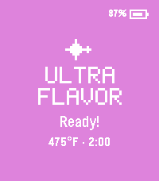

<!-- Generated by scripts/update_app_directory.py: do not edit by hand -->
[← All Pebble Developers](../developers.md)

# DocsLab

*1 app · Last updated 2026-11-23 · [About these lists](../about-app-lists.md)*

Links: [Pebble App Store](https://apps.repebble.com/apps/dev/docslab_bdf4d66220c264da13575ed1) · [GitHub (DocDPhD)](https://github.com/DocDPhD)

<h2 class="app-name" id="app-be1e222756b94a17b43008dd"><a href="https://apps.repebble.com/be1e222756b94a17b43008dd">Puffble</a> v0.6.0</h2>
<a class="app-source" href="https://github.com/DocDPhD/Puffble/releases" title="Source code" data-search-exclude>View source</a>

App

Other Released 2026-11-17 Updated 2026-11-19

Runs on: Round 2, Time 2

Puffble puts your Puffco Proxy on your Pebble! See the live temperature, flip between your four heat profiles, start a session with a deliberate hold, and watch the countdown, all without reaching…

