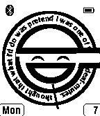

<!-- Generated by scripts/update_app_directory.py: do not edit by hand -->
[← All Pebble Developers](../developers.md)

# docsmooth

*1 watchface · Last updated 2026-10-11 · [About these lists](../about-app-lists.md)*

Links: [Pebble App Store](https://apps.repebble.com/apps/dev/docsmooth_52f2582fc41172eebc00151d) · [GitHub (docsmooth)](https://github.com/docsmooth)

<h2 class="app-name" id="app-5342beed623a497d30000022"><a href="https://apps.repebble.com/5342beed623a497d30000022">Laughing Man</a> v2.12</h2>
<a class="app-source" href="https://github.com/docsmooth/laughingman" title="Source code" data-search-exclude>View source</a>

Watchface

Released 2014-04-07 Updated 2014-12-02

Runs on: Time 2, Pebble 2 Duo, Pebble 2, Time, Classic

The Laughing Man logo from Ghost in the Shell (GitS), analog watchface. The spinning words are the minute hand, and the ballcap is the hour hand. Copyright owned by ProductionIG permits personal…

