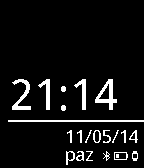

<!-- Generated by scripts/update_app_directory.py: do not edit by hand -->
[← All Pebble Developers](../developers.md)

# Dogan Can Kilment

*1 watchface · Last updated 2026-10-11 · [About these lists](../about-app-lists.md)*

Links: [Pebble App Store](https://apps.repebble.com/apps/dev/dogan-can-kilment_536fc4e16ce5fc7ba00000fe) · [GitHub (dogancankilment)](https://github.com/dogancankilment)

<h2 class="app-name" id="app-536fc7e2190f07bd120001b0"><a href="https://apps.repebble.com/536fc7e2190f07bd120001b0">WatchFace-TR</a> v1.0</h2>
<a class="app-source" href="https://github.com/dogancankilment/watchface-tr" title="Source code" data-search-exclude>View source</a>

Watchface

Released 2014-05-11 Updated 2014-05-11

Runs on: Time 2, Pebble 2 Duo, Pebble 2, Time, Classic

-&gt; Time -&gt; GG/AA/YYYY -&gt; Day / Bluetooth Connection / Battery This watchface translated to Turkish by watchface project. -&gt; Saat -&gt; Gün/Ay/Yıl -&gt; Gün / Bluetooth Bağlantısı / Pil

