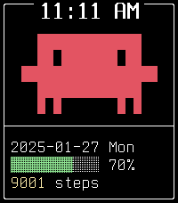

<!-- Generated by scripts/update_app_directory.py: do not edit by hand -->
[← All Pebble Developers](../developers.md)

# dogspeed

*1 watchface · Last updated 2026-11-09 · [About these lists](../about-app-lists.md)*

Links: [Pebble App Store](https://apps.repebble.com/apps/dev/dogspeed_07a2977eb53aa601799bff69)

<h2 class="app-name" id="app-c900b6becb16414f84e788ed"><a href="https://apps.repebble.com/c900b6becb16414f84e788ed">codewatch</a> v2.4.0</h2>
<a class="app-source" href="https://tangled.org/dogspeed.fyi/codewatch" title="Source code" data-search-exclude>View source</a>

Watchface

Released 2026-04-12 Updated 2026-11-05

Runs on: Round 2, Time 2

codewatch puts your coding buddy on your wrist. A terminal-aesthetic watchface inspired by Claude Code, featuring a code creature that lives on your screen and comes alive with a flick of your…

