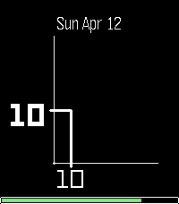
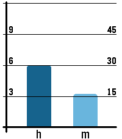

<!-- Generated by scripts/update_app_directory.py: do not edit by hand -->
[← All Pebble Developers](../developers.md)

# Dominik Hauser

*3 watchfaces · Last updated 2026-10-12 · [About these lists](../about-app-lists.md)*

Links: [Pebble App Store](https://apps.repebble.com/apps/dev/dominik-hauser_ab6e7e563a14ef03bb88d9a6) · [GitHub (dasdom)](https://github.com/dasdom)

<button type="button" data-filter="all" aria-pressed="true">All 3</button><button type="button" data-filter="watchface" aria-pressed="false">Watchfaces 3</button><button type="button" data-filter="watchapp" aria-pressed="false" disabled>Apps 0</button>

<label class="dev-sort">Sort by <select><option value="updated">Recently updated</option><option value="released">Newest release</option><option value="title">A–Z</option></select></label>

<h2 class="app-name" id="app-5bf51e42121c464ebd50192a"><a href="https://apps.repebble.com/5bf51e42121c464ebd50192a">Poly Numbers One</a> v1.0</h2>
<a class="app-source" href="https://github.com/dasdom/Pebble_PolyNumbersOne_Watchface" title="Source code" data-search-exclude>View source</a>

Watchface

MIT Released 2026-04-23 Updated 2026-04-23

Runs on: Round 2, Time 2, Pebble 2 Duo, Pebble 2, Time Round, Time, Classic

- Support for 12/24 hours - Nice numbers

<h2 class="app-name" id="app-218d8ca4983c4bf2a604589d"><a href="https://apps.repebble.com/218d8ca4983c4bf2a604589d">Coordinates</a> v1.0</h2>
<a class="app-source" href="https://github.com/dasdom/Pebble_Coordinates_Watchface" title="Source code" data-search-exclude>View source</a>

Watchface

MIT Released 2026-04-12 Updated 2026-04-12

Runs on: Round 2, Time 2, Pebble 2 Duo, Pebble 2, Time Round, Time, Classic

Hours are shown on the y-axis and minutes are shown on the x-axis. The watch face gives you a sense of how many minutes have passed this hour and how many hours have passed today. The shape of the…

<h2 class="app-name" id="app-8a6bdc2d8d254225b3f437dc"><a href="https://apps.repebble.com/8a6bdc2d8d254225b3f437dc">BarsOne</a> v1.0</h2>
<a class="app-source" href="https://github.com/dasdom/pebble_watch_face_bars_one" title="Source code" data-search-exclude>View source</a>

Watchface

MIT Released 2026-02-20 Updated 2026-02-20

Runs on: Time 2, Pebble 2 Duo, Pebble 2, Time, Classic

Watch face for all the bar chart lovers out there.

