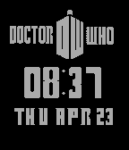
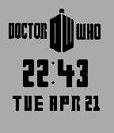
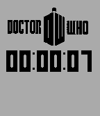

<!-- Generated by scripts/update_app_directory.py: do not edit by hand -->
[← All Pebble Developers](../developers.md)

# Don Pollitz

*3 watchfaces · Last updated 2026-10-12 · [About these lists](../about-app-lists.md)*

Links: [Pebble App Store](https://apps.repebble.com/apps/dev/don-pollitz_549c30a3ad219e5ece00026f) · [GitHub (chaos2007)](https://github.com/chaos2007)

<button type="button" data-filter="all" aria-pressed="true">All 3</button><button type="button" data-filter="watchface" aria-pressed="false">Watchfaces 3</button><button type="button" data-filter="watchapp" aria-pressed="false" disabled>Apps 0</button>

<label class="dev-sort">Sort by <select><option value="updated">Recently updated</option><option value="released">Newest release</option><option value="title">A–Z</option></select></label>

<h2 class="app-name" id="app-5538f5bbeace6f4547000080"><a href="https://apps.repebble.com/5538f5bbeace6f4547000080">WhoWatchInverted</a> v1.0</h2>
<a class="app-source" href="https://github.com/chaos2007/whoWatchInverted" title="Source code" data-search-exclude>View source</a>

Watchface

No licence Released 2015-04-23 Updated 2015-04-23

Runs on: Time 2, Pebble 2 Duo, Pebble 2, Time, Classic

A request was made for a version of the WhoWatch with inverted color. I&#x27;m currently looking into having one watchface with configurable settings. Until then, here it is.

<h2 class="app-name" id="app-553718f0166e9ce5fe000046"><a href="https://apps.repebble.com/553718f0166e9ce5fe000046">WhoWatch</a> v1.0</h2>
<a class="app-source" href="https://github.com/chaos2007/doctorWhoTime" title="Source code" data-search-exclude>View source</a>

Watchface

No licence Released 2015-04-22 Updated 2015-04-22

Runs on: Time 2, Pebble 2 Duo, Pebble 2, Time, Classic

A simple watchface for those who like Doctor Who.

<h2 class="app-name" id="app-55371aae1fa0b379fc000028"><a href="https://apps.repebble.com/55371aae1fa0b379fc000028">WhoStopWatch</a> v1.0</h2>
<a class="app-source" href="https://github.com/chaos2007/doctorWhoStopWatch" title="Source code" data-search-exclude>View source</a>

Watchface

No licence Released 2015-04-22 Updated 2015-04-22

Runs on: Time 2, Pebble 2 Duo, Pebble 2, Time, Classic

This is a Doctor Who watch face that functions as a stopwatch. When the face is selected, it begins a timer. I made this really for me so that I could have quick access to a stopwatch.

