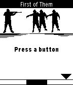

<!-- Generated by scripts/update_app_directory.py: do not edit by hand -->
[← All Pebble Developers](../developers.md)

# Donk Studios

*1 app · Last updated 2026-10-11 · [About these lists](../about-app-lists.md)*

Links: [Pebble App Store](https://apps.repebble.com/apps/dev/donk-studios_53b4d4b0faff49b44300016d) · [GitHub (peperodo)](https://github.com/peperodo)

<h2 class="app-name" id="app-53dfd081107b2280a00000fa"><a href="https://apps.repebble.com/53dfd081107b2280a00000fa">First of Them</a> v1.0.1</h2>
<a class="app-source" href="https://github.com/peperodo/first-of-them" title="Source code" data-search-exclude>View source</a>

App

Released 2014-08-04 Updated 2014-08-05

Runs on: Time 2, Pebble 2 Duo, Pebble 2, Time, Classic

Follow the cursor moving along a meter at the bottom of the screen. Press when the cursor is in the zone of the black area of the meter. This will allow your character to trigger his rifle to…

