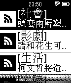

<!-- Generated by scripts/update_app_directory.py: do not edit by hand -->
[← All Pebble Developers](../developers.md)

# Donma

*1 app · Last updated 2026-10-12 · [About these lists](../about-app-lists.md)*

Links: [Pebble App Store](https://apps.repebble.com/apps/dev/donma_5507d1a1359e14a4320000d7)

<h2 class="app-name" id="app-5512dac6e28a65b3670000e7"><a href="https://apps.repebble.com/5512dac6e28a65b3670000e7">TaiwanNewsMessage</a> v1.0</h2>
<a class="app-source" href="http://no2don.com" title="Source code" data-search-exclude>View source</a>

App

Released 2015-03-25 Updated 2015-03-25

Runs on: Time 2, Pebble 2 Duo, Pebble 2, Time, Classic

台灣新聞快訊，台灣重大新聞標題，快速瀏覽!!

