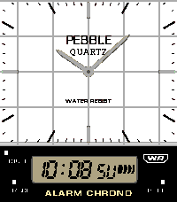
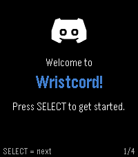
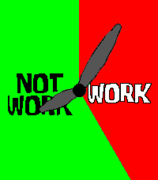

<!-- Generated by scripts/update_app_directory.py: do not edit by hand -->
[← All Pebble Developers](../developers.md)

# dotJustin

*2 watchfaces and 1 app · Last updated 2026-10-11 · [About these lists](../about-app-lists.md)*

Links: [Pebble App Store](https://apps.repebble.com/apps/dev/dotjustin_4b6299c72480e7810068a64a) · [GitHub (dot-Justin)](https://github.com/dot-Justin)

<button type="button" data-filter="all" aria-pressed="true">All 3</button><button type="button" data-filter="watchface" aria-pressed="false">Watchfaces 2</button><button type="button" data-filter="watchapp" aria-pressed="false">Apps 1</button>

<label class="dev-sort">Sort by <select><option value="updated">Recently updated</option><option value="released">Newest release</option><option value="title">A–Z</option></select></label>

<h2 class="app-name" id="app-ddf9f5400c1e4c62911fcc56"><a href="https://apps.repebble.com/ddf9f5400c1e4c62911fcc56">AQ-800</a> v1.2.0</h2>
<a class="app-source" href="https://github.com/dot-Justin/Pebble-WF-Casio-AQ-800" title="Source code" data-search-exclude>View source</a>

Watchface

Released 2026-06-06 Updated 2026-06-15

Runs on: Time 2

Faithful recreation of the classic 80s ana-digi dual-display watch for Pebble Time 2. Metal hands that catch the light as they sweep, applied markers, grid dial, and a segment-true LCD showing…

<h2 class="app-name" id="app-c61d68498f25458ebc9a2ec6"><a href="https://apps.repebble.com/c61d68498f25458ebc9a2ec6">Wristcord</a> v1.0.0</h2>
<a class="app-source" href="https://github.com/dot-Justin/Wristcord" title="Source code" data-search-exclude>View source</a>

App

Released 2026-06-08 Updated 2026-06-08

Runs on: Time 2

Discord on your wrist! Browse your servers, follow chats, and send a reply with your voice, right from Pebble Time 2. Heads up, Wristcord is a selfbot; by using it you accept that selfbotting is…

<h2 class="app-name" id="app-2498bd8fb81f496ebbb3f90b"><a href="https://apps.repebble.com/2498bd8fb81f496ebbb3f90b">Work / Not Work</a> v1.0.2</h2>
<a class="app-source" href="https://github.com/dot-Justin/Pebble-WF-Work-Not-Work" title="Source code" data-search-exclude>View source</a>

Watchface

Released 2026-06-07 Updated 2026-06-07

Runs on: Time 2

The legendary WORK / NOT WORK watch from Bikini Bottom. Propeller hands sweep a red WORK wedge and a green NOT WORK zone. Set your own work hours and days; on days off the whole dial goes green…

