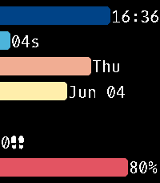

<!-- Generated by scripts/update_app_directory.py: do not edit by hand -->
[← All Pebble Developers](../developers.md)

# DougyD

*1 watchface · Last updated 2026-10-12 · [About these lists](../about-app-lists.md)*

Links: [Pebble App Store](https://apps.repebble.com/apps/dev/dougyd_9127420ceb55fdf6e4ab249c) · [GitHub (dougyd92)](https://github.com/dougyd92) · [Website (dougdejesus.com)](https://dougdejesus.com/projects/progbars/)

<h2 class="app-name" id="app-d44c90538b684e119ca84204"><a href="https://apps.repebble.com/d44c90538b684e119ca84204">ProgBars</a> v2.0.2</h2>
<a class="app-source" href="https://github.com/dougyd92/ProgBars" title="Source code" data-search-exclude>View source</a>

Watchface

No licence Released 2026-06-04 Updated 2026-06-04

Runs on: Time 2, Pebble 2 Duo, Pebble 2, Time, Classic

ProgBars is a super-customizable watchface that displays all the information you would ever need on a watch in a compact, vibrant, easy to read fashion. Choose different bars to show time, date…

