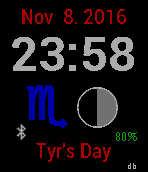
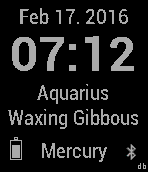

<!-- Generated by scripts/update_app_directory.py: do not edit by hand -->
[← All Pebble Developers](../developers.md)

# Dr. David Brown

*4 watchfaces · Last updated 2026-10-11 · [About these lists](../about-app-lists.md)*

Links: [Pebble App Store](https://apps.repebble.com/apps/dev/dr-david-brown_55315ebd8763f8a6e5000043) · [GitHub (revdrbrown)](https://github.com/revdrbrown)

<button type="button" data-filter="all" aria-pressed="true">All 4</button><button type="button" data-filter="watchface" aria-pressed="false">Watchfaces 4</button><button type="button" data-filter="watchapp" aria-pressed="false" disabled>Apps 0</button>

<label class="dev-sort">Sort by <select><option value="updated">Recently updated</option><option value="released">Newest release</option><option value="title">A–Z</option></select></label>

<h2 class="app-name" id="app-5692db642845db3380000079"><a href="https://apps.repebble.com/5692db642845db3380000079">Pagan</a> v2.0</h2>
<a class="app-source" href="https://github.com/revdrbrown/PebblePagan" title="Source code" data-search-exclude>View source</a>

Watchface

Released 2016-01-10 Updated 2016-11-09

Runs on: Round 2, Time 2, Pebble 2 Duo, Pebble 2, Time Round, Time, Classic

Displays date, time, current astrological sun sign, a graphical depiction of the lunar phase and the planet-based day of the week. On solstices, equinoxes and cross-quarter days, the planetary day…

<h2 class="app-name" id="app-56beb07c3e48f5697a000024"><a href="https://apps.repebble.com/56beb07c3e48f5697a000024">Masonic</a> v1.2</h2>
<a class="app-source" href="https://github.com/revdrbrown/PebbleMasonic" title="Source code" data-search-exclude>View source</a>

Watchface

Released 2016-02-13 Updated 2016-07-10

Runs on: Round 2, Time 2, Pebble 2 Duo, Pebble 2, Time Round, Time, Classic

Watchface for Master Masons featuring a background of a square and compass enclosing the letter G. The analog watchface marks the hour with a square, the minute with a triangle and the seconds…

<h2 class="app-name" id="app-577fe87166202a9b8d00041f"><a href="https://apps.repebble.com/577fe87166202a9b8d00041f">Elder Sign</a> v1.0</h2>
<a class="app-source" href="https://github.com/revdrbrown/PebbleElderSign" title="Source code" data-search-exclude>View source</a>

Watchface

Released 2016-07-08 Updated 2016-07-10

Runs on: Round 2, Time 2, Pebble 2 Duo, Pebble 2, Time Round, Time, Classic

The Elder Sign watchface elements refer to the Cthulhu mythos. The main display shows the Elder Sign with the watch hands represented by a circle (seconds), triangle (minute) and square (hour)…

<h2 class="app-name" id="app-56c50baea02787929a000040"><a href="https://apps.repebble.com/56c50baea02787929a000040">Astrological</a> v1.0</h2>
<a class="app-source" href="http://github.com/revdrbrown/PebbleAstrological" title="Source code" data-search-exclude>View source</a>

Watchface

No licence Released 2016-02-18 Updated 2016-02-18

Runs on: Round 2, Time 2, Pebble 2 Duo, Pebble 2, Time Round, Time, Classic

Astrological is a text-based watchface showing: * Date * Time * Sun Sign * Lunar Phase (as text) * Planet associated with Day of Week * Equinoxes and Solstices * Battery Level Indicator *…

