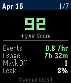

<!-- Generated by scripts/update_app_directory.py: do not edit by hand -->
[← All Pebble Developers](../developers.md)

# Dragid10

*1 app · Last updated 2026-11-02 · [About these lists](../about-app-lists.md)*

Links: [Pebble App Store](https://apps.repebble.com/apps/dev/dragid10_5482bdbd2d95f42c4b21f5f1) · [GitHub (dragid10)](https://github.com/dragid10) · [Website (alexo.dev)](https://alexo.dev/projects/)

<h2 class="app-name" id="app-bca44cfa4de14135915afbec"><a href="https://apps.repebble.com/bca44cfa4de14135915afbec">ResMed CPAP Stats</a> v1.3.0</h2>
<a class="app-source" href="https://github.com/dragid10/resmedStatsPebbleApp" title="Source code" data-search-exclude>View source</a>

App

MIT Released 2026-04-16 Updated 2026-10-30

Runs on: Round 2, Time 2, Pebble 2 Duo, Pebble 2, Time Round, Time, Classic

CPAP sleep stats from ResMed myAir

