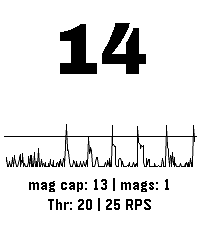

<!-- Generated by scripts/update_app_directory.py: do not edit by hand -->
[← All Pebble Developers](../developers.md)

# DRC

*1 app · Last updated 2026-10-12 · [About these lists](../about-app-lists.md)*

Links: [Pebble App Store](https://apps.repebble.com/apps/dev/drc_f9f561c351b06fcf9db54d67) · [GitHub (dcanelhas)](https://github.com/dcanelhas)

<h2 class="app-name" id="app-d9ae0d91c6b94bd2add22405"><a href="https://apps.repebble.com/d9ae0d91c6b94bd2add22405">Shot &amp; Recoil Counter</a> v1.1.2</h2>
<a class="app-source" href="https://github.com/dcanelhas/ShotCounter" title="Source code" data-search-exclude>View source</a>

App

Other Released 2026-08-06 Updated 2026-09-01

Runs on: Time 2

This app uses the accelerometer to measure recoil (as spikes in acceleration) in order to count the number of shots taken in sports shooting. Settings: - Color Theme (default: Dark Mono) - Recoil…

