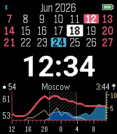

<!-- Generated by scripts/update_app_directory.py: do not edit by hand -->
[← All Pebble Developers](../developers.md)

# Dreamkeeper

*1 watchface · Last updated 2026-10-12 · [About these lists](../about-app-lists.md)*

Links: [Pebble App Store](https://apps.repebble.com/apps/dev/dreamkeeper_9860df6abfdaeba4fa867442) · [GitHub (Dreamkeeper)](https://github.com/Dreamkeeper) · [Website (dkvasnikov.ru)](https://dkvasnikov.ru/)

<h2 class="app-name" id="app-707ebcb9433f49b8b2e2515f"><a href="https://apps.repebble.com/707ebcb9433f49b8b2e2515f">YaForecasWatch2</a> v1.34.14</h2>
<a class="app-source" href="https://github.com/Dreamkeeper/YaForecasWatch2" title="Source code" data-search-exclude>View source</a>

Watchface · <a href="https://forum.rebble.io/t/1075" title="Discuss this app on the Rebble forum" data-search-exclude>Forum thread</a>

GPL-3.0 Released 2026-06-20 Updated 2026-08-18

Runs on: Time 2, Pebble 2 Duo, Pebble 2, Time, Classic

YaForecasWatch2 keeps the compact calendar and forecast layout of ForecasWatch2 while adding better support for users outside the original Weather Underground/OpenWeatherMap flow. New in this…

