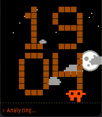

<!-- Generated by scripts/update_app_directory.py: do not edit by hand -->
[← All Pebble Developers](../developers.md)

# Drew Hutton (Yoroshi)

*1 watchface · Last updated 2026-10-12 · [About these lists](../about-app-lists.md)*

Links: [Pebble App Store](https://apps.repebble.com/apps/dev/drew-hutton-yoroshi_f5b5d7f2003a693d16ebf63f) · [GitHub (coredevices)](https://github.com/coredevices)

<h2 class="app-name" id="app-ed402248906d4478982b0c4d"><a href="https://apps.repebble.com/ed402248906d4478982b0c4d">Claude Code Mascot</a> v1.0.0</h2>
<a class="app-source" href="https://github.com/coredevices/pebble-watchface-agent-skill" title="Source code" data-search-exclude>View source</a>

Watchface

No licence Released 2026-04-13 Updated 2026-04-13

Runs on: Round 2, Time 2, Pebble 2 Duo, Pebble 2, Time Round, Time, Classic

An animated watchface featuring the Claude Code mascot — a tiny AI character that walks, runs, thinks, and sleeps across a pixel-art terminal display. Shows time in a chunky orange pixel font with…

