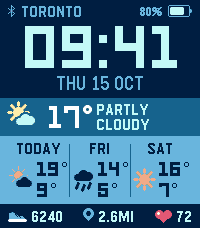

<!-- Generated by scripts/update_app_directory.py: do not edit by hand -->
[← All Pebble Developers](../developers.md)

# Drew Warkentin

*1 watchface · Last updated 2026-11-09 · [About these lists](../about-app-lists.md)*

Links: [Pebble App Store](https://apps.repebble.com/apps/dev/drew-warkentin_12f79c58d4e4222011cb9cf0) · [GitHub (drewdulz)](https://github.com/drewdulz)

<h2 class="app-name" id="app-a4aed14ba10c43d9a8b7c868"><a href="https://apps.repebble.com/a4aed14ba10c43d9a8b7c868">Clearline</a> v1.1.0</h2>
<a class="app-source" href="https://github.com/drewdulz/pebble" title="Source code" data-search-exclude>View source</a>

Watchface

No licence Released 2026-10-15 Updated 2026-10-16

Runs on: Time 2

Clearline is a bold, colour-block watchface for Pebble Time 2 that puts the weather front and centre. • Big, blocky time and the date • Current conditions with a clean, flat weather icon • Today…

