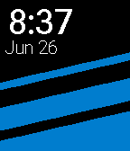

<!-- Generated by scripts/update_app_directory.py: do not edit by hand -->
[← All Pebble Developers](../developers.md)

# drewatk

*2 watchfaces · Last updated 2026-10-11 · [About these lists](../about-app-lists.md)*

Links: [Pebble App Store](https://apps.repebble.com/apps/dev/drewatk_57597dd706738d271e000020) · [GitHub (drewatk)](https://github.com/drewatk)

<button type="button" data-filter="all" aria-pressed="true">All 2</button><button type="button" data-filter="watchface" aria-pressed="false">Watchfaces 2</button><button type="button" data-filter="watchapp" aria-pressed="false" disabled>Apps 0</button>

<label class="dev-sort">Sort by <select><option value="updated">Recently updated</option><option value="released">Newest release</option><option value="title">A–Z</option></select></label>

<h2 class="app-name" id="app-577300c2ba2fe566a100040c"><a href="https://apps.repebble.com/577300c2ba2fe566a100040c">Triangles</a> v1.0</h2>
<a class="app-source" href="https://github.com/drewatk/triangles" title="Source code" data-search-exclude>View source</a>

Watchface

Released 2016-06-28 Updated 2016-06-28

Runs on: Round 2, Time 2, Time Round, Time

Triangles Watchface Image by Vecree.com (CC BY-SA 2.0) Robotech Font by Gustavo Paz (CC BY-SA 4.0)

<h2 class="app-name" id="app-57704f8d6c2104d9b1000171"><a href="https://apps.repebble.com/57704f8d6c2104d9b1000171">Clean Stripes</a> v1.1</h2>
<a class="app-source" href="https://github.com/drewatk/cleanStripes" title="Source code" data-search-exclude>View source</a>

Watchface

Released 2016-06-26 Updated 2016-06-27

Runs on: Time 2, Pebble 2 Duo, Pebble 2, Time, Classic

Simple watchface showing the date and time. Email me if you have a suggestion!

