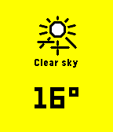

<!-- Generated by scripts/update_app_directory.py: do not edit by hand -->
[← All Pebble Developers](../developers.md)

# drkitt

*1 app · Last updated 2026-10-12 · [About these lists](../about-app-lists.md)*

Links: [Rebble App Store](https://apps.rebble.io/en_US/developer/60e088801342ae01703c842e/1) · [GitHub (drkitt)](https://github.com/drkitt)

<h2 class="app-name" id="app-60e088801342ae01703c8430"><a href="https://apps.rebble.io/en_US/application/60e088801342ae01703c8430">Instaweather</a> v1.0</h2>
<a class="app-source" href="https://github.com/drkitt/instaweather" title="Source code" data-search-exclude>View source</a>

App

MIT Released 2021-07-03 Updated 2021-07-03 Rebble App Store

Runs on: Round 2, Time 2, Pebble 2 Duo, Pebble 2, Time Round, Time, Classic

Instaweather is a weather app that fetches and caches weather data in the background every hour so you can view up-to-date weather instantly.

