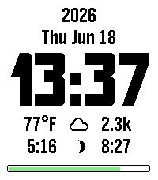

<!-- Generated by scripts/update_app_directory.py: do not edit by hand -->
[← All Pebble Developers](../developers.md)

# drod

*1 watchface · Last updated 2026-10-11 · [About these lists](../about-app-lists.md)*

Links: [Pebble App Store](https://apps.repebble.com/apps/dev/drod_ddb35e676d571d48c7a45045) · [GitHub (drod0258)](https://github.com/drod0258)

<h2 class="app-name" id="app-5eda31d774a34edeb1c87a39"><a href="https://apps.repebble.com/5eda31d774a34edeb1c87a39">BigInfo</a> v2.3.1</h2>
<a class="app-source" href="https://github.com/drod0258/BigInfoPebble" title="Source code" data-search-exclude>View source</a>

Watchface

Released 2026-04-22 Updated 2026-06-26

Runs on: Round 2, Time 2, Pebble 2 Duo, Pebble 2, Time, Classic

A simple, clean Pebble watchface with a large, easy-to-read font. Displays the essentials at a glance, all configurable so you can hide what you don&#x27;t need. Features: - Large time displayed in a…

