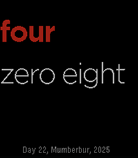

<!-- Generated by scripts/update_app_directory.py: do not edit by hand -->
[← All Pebble Developers](../developers.md)

# DrPunchman

*1 watchface · Last updated 2026-10-12 · [About these lists](../about-app-lists.md)*

Links: [Rebble App Store](https://apps.rebble.io/en_US/developer/5b9559b9ba301a00014b86f2/1) · [Website (drpunchman.com)](https://drpunchman.com)

<h2 class="app-name" id="app-692159cb7cdf9d000985e1bd"><a href="https://apps.rebble.io/en_US/application/692159cb7cdf9d000985e1bd">Zork Face</a> v1.0</h2>
<a class="app-source" href="https://drpunchman.com/index.php?❤=BLOG&amp;★=CLOUD_PEBBLE" title="Source code" data-search-exclude>View source</a>

Watchface

Released 2025-11-22 Updated 2025-11-22 Rebble App Store

Runs on: Time 2, Pebble 2 Duo, Pebble 2, Time, Classic

It is a text watch face that has holidays based off the Zork calendar just to be difficult.

