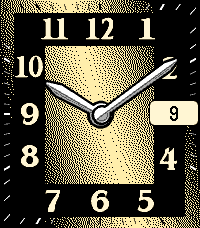
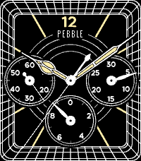
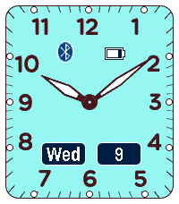
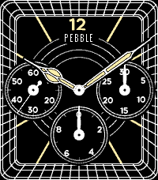
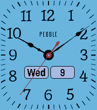
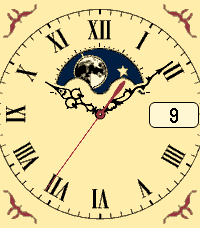

<!-- Generated by scripts/update_app_directory.py: do not edit by hand -->
[← All Pebble Developers](../developers.md)

# drwrose

*6 watchfaces and 1 app · Last updated 2026-10-11 · [About these lists](../about-app-lists.md)*

Links: [Pebble App Store](https://apps.repebble.com/apps/dev/drwrose_52995888e627ce1aff000009) · [GitHub (drwrose)](https://github.com/drwrose)

<button type="button" data-filter="all" aria-pressed="true">All 7</button><button type="button" data-filter="watchface" aria-pressed="false">Watchfaces 6</button><button type="button" data-filter="watchapp" aria-pressed="false">Apps 1</button>

<label class="dev-sort">Sort by <select><option value="updated">Recently updated</option><option value="released">Newest release</option><option value="title">A–Z</option></select></label>

<h2 class="app-name" id="app-52999691129af7543000004c"><a href="https://apps.repebble.com/52999691129af7543000004c">Rosewright E</a> v5.1.0</h2>
<a class="app-source" href="https://github.com/drwrose/rosewright.git" title="Source code" data-search-exclude>View source</a>

Watchface

Released 2013-11-30 Updated 2026-05-20

Runs on: Round 2, Time 2, Pebble 2 Duo, Pebble 2, Time Round, Time, Classic

A particularly excellent imitation of a real, physical watchface. Like all Rosewright faces, it is extensively configurable including multiple face options, second hand, hour alert, bluetooth…

<h2 class="app-name" id="app-529993a5e627cef6e100004b"><a href="https://apps.repebble.com/529993a5e627cef6e100004b">Rosewright Chronograph</a> v5.1.0</h2>
<a class="app-source" href="https://github.com/drwrose/rosewright.git" title="Source code" data-search-exclude>View source</a>

App

Released 2013-11-30 Updated 2026-05-20

Runs on: Round 2, Time 2, Pebble 2 Duo, Pebble 2, Time Round, Time, Classic

An analog &quot;Chronograph&quot; three-subdial watchface. It&#x27;s a fully functioning stopwatch with start/stop and lap buttons, and 0.1-second resolution. Like all Rosewright faces, it is extensively…

<h2 class="app-name" id="app-5299958de627ce91ae000053"><a href="https://apps.repebble.com/5299958de627ce91ae000053">Rosewright D</a> v5.1.0</h2>
<a class="app-source" href="https://github.com/drwrose/rosewright.git" title="Source code" data-search-exclude>View source</a>

Watchface

Released 2013-11-30 Updated 2026-05-19

Runs on: Round 2, Time 2, Pebble 2 Duo, Pebble 2, Time Round, Time, Classic

A straightforward analog watchface with clean, white hands on a gray background. Like all Rosewright faces, it is extensively configurable including multiple face options, second hand, hour alert…

<h2 class="app-name" id="app-57d7678cffca49beb50003c1"><a href="https://apps.repebble.com/57d7678cffca49beb50003c1">Rosewright C</a> v5.1.0</h2>
<a class="app-source" href="https://github.com/drwrose/rosewright.git" title="Source code" data-search-exclude>View source</a>

Watchface

Released 2016-09-13 Updated 2026-05-19

Runs on: Round 2, Time 2, Pebble 2 Duo, Pebble 2, Time Round, Time, Classic

This is a watchface version of Rosewright Chronograph. Please install Rosewright Chronograph (listed among the apps) if you are looking for a functional chonograph watch. Rosewright C is a…

<h2 class="app-name" id="app-5299743a129af7a144000037"><a href="https://apps.repebble.com/5299743a129af7a144000037">Rosewright B</a> v5.1.0</h2>
<a class="app-source" href="https://github.com/drwrose/rosewright.git" title="Source code" data-search-exclude>View source</a>

Watchface

Released 2013-11-30 Updated 2026-05-19

Runs on: Round 2, Time 2, Pebble 2 Duo, Pebble 2, Time Round, Time, Classic

A clean and elegant analog watch. Like all Rosewright faces, it is extensively configurable including multiple face options, second hand, hour alert, bluetooth, battery, and day/date/month etc. in…

<h2 class="app-name" id="app-52997231129af73409000033"><a href="https://apps.repebble.com/52997231129af73409000033">Rosewright A</a> v5.1.0</h2>
<a class="app-source" href="https://github.com/drwrose/rosewright.git" title="Source code" data-search-exclude>View source</a>

Watchface

Released 2013-11-30 Updated 2026-05-12

Runs on: Round 2, Time 2, Pebble 2 Duo, Pebble 2, Time Round, Time, Classic

An elegant analog watchface, with intricate hands made to resemble a classic grandfather clock. Like all Rosewright faces, it is extensively configurable including multiple face options, second…

<h2 class="app-name" id="app-529997b1e627ceb4e200005a"><a href="https://apps.repebble.com/529997b1e627ceb4e200005a">The 12 Doctors</a> v4.6</h2>
<a class="app-source" href="https://github.com/drwrose/doctors.git" title="Source code" data-search-exclude>View source</a>

Watchface

Released 2013-11-30 Updated 2016-11-27

Runs on: Round 2, Time 2, Pebble 2 Duo, Pebble 2, Time Round, Time, Classic

12 Doctors and 12 hours: a different Doctor for each hour of the day. You can read the time by identifying the face of the Doctor for the hour, combined with the minutes displayed in the lower right.

