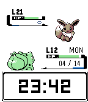
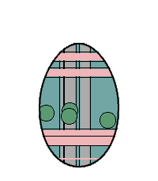
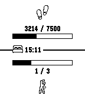
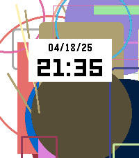
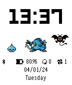

<!-- Generated by scripts/update_app_directory.py: do not edit by hand -->
[← All Pebble Developers](../developers.md)

# Dscheinah

*3 watchfaces and 3 apps · Last updated 2026-10-11 · [About these lists](../about-app-lists.md)*

Links: [Pebble App Store](https://apps.repebble.com/apps/dev/dscheinah_5bef203e74e2a60001cef482) · [GitHub (dscheinah)](https://github.com/dscheinah)

<button type="button" data-filter="all" aria-pressed="true">All 6</button><button type="button" data-filter="watchface" aria-pressed="false">Watchfaces 3</button><button type="button" data-filter="watchapp" aria-pressed="false">Apps 3</button>

<label class="dev-sort">Sort by <select><option value="updated">Recently updated</option><option value="released">Newest release</option><option value="title">A–Z</option></select></label>

<h2 class="app-name" id="app-620187963ea70300099815fa"><a href="https://apps.repebble.com/620187963ea70300099815fa">Pokémon Gamified Watchface</a> v5.9</h2>
<a class="app-source" href="https://github.com/dscheinah/pkmn-watchface" title="Source code" data-search-exclude>View source</a>

Watchface · <a href="https://forum.rebble.io/t/1228" title="Discuss this app on the Rebble forum" data-search-exclude>Forum thread</a>

Released 2022-02-07 Updated 2026-08-12

Runs on: Round 2, Time 2, Pebble 2 Duo, Pebble 2, Time Round, Time, Classic

This is a fan art inspired by Pokémon. The watch uses the battlefield to render date, time and various health statistics: - Enemy level increases with sleep time. - Own level increases with steps…

<h2 class="app-name" id="app-4392f34266ad403eadbe4247"><a href="https://apps.repebble.com/4392f34266ad403eadbe4247">Easter Egg</a> v1.3</h2>
<a class="app-source" href="https://github.com/dscheinah/easter-egg-pebble" title="Source code" data-search-exclude>View source</a>

App · <a href="https://forum.rebble.io/t/835" title="Discuss this app on the Rebble forum" data-search-exclude>Forum thread</a>

Released 2026-04-06 Updated 2026-04-18

Runs on: Round 2, Time 2, Pebble 2 Duo, Pebble 2, Time Round, Time

Meet Eggy, the Easter Egg! 🥚 What starts as a plain white egg won’t stay that way for long. As you move, rest, and go about your day, Eggy evolves—unlocking new features and surprises along the…

<h2 class="app-name" id="app-67cab3bad2acb301fae26dee"><a href="https://apps.repebble.com/67cab3bad2acb301fae26dee">Get active!</a> v2.0</h2>
<a class="app-source" href="https://github.com/dscheinah/get-active-pebble" title="Source code" data-search-exclude>View source</a>

App

Released 2025-03-07 Updated 2025-06-03

Runs on: Round 2, Time 2, Pebble 2 Duo, Pebble 2, Time Round, Time

This app helps you to reach your health goals. It can be configured to notify you: - If you didn&#x27;t spent enough time active within the last hour - If you are about to not reach your daily step…

<h2 class="app-name" id="app-6802c8906b6dee0009d0cc36"><a href="https://apps.repebble.com/6802c8906b6dee0009d0cc36">Artface</a> v1.1</h2>
<a class="app-source" href="https://github.com/dscheinah/artface" title="Source code" data-search-exclude>View source</a>

Watchface

Released 2025-04-18 Updated 2025-04-29

Runs on: Round 2, Time 2, Pebble 2 Duo, Pebble 2, Time Round, Time, Classic

This watchface creates a random background out of up to 30 different shapes. It changes one shape every hour.

<h2 class="app-name" id="app-6598a3a2e46ef1043582fff3"><a href="https://apps.repebble.com/6598a3a2e46ef1043582fff3">Metronome</a> v1.1</h2>
<a class="app-source" href="https://github.com/dscheinah/metronome-pebble" title="Source code" data-search-exclude>View source</a>

App

Released 2024-01-06 Updated 2024-01-06

Runs on: Round 2, Time 2, Pebble 2 Duo, Pebble 2, Time Round, Time, Classic

This is a haptic metronome app for Pebble devices. It gives you visual and vibration feedback to display the tempo. It is also possible to configure the time signature and tap in a tempo. The app…

<h2 class="app-name" id="app-6503faaa81ffd2007375874c"><a href="https://apps.repebble.com/6503faaa81ffd2007375874c">DQM Gamified Watchface</a> v1.4</h2>
<a class="app-source" href="https://github.com/dscheinah/dqm-watchface" title="Source code" data-search-exclude>View source</a>

Watchface

Released 2023-09-15 Updated 2023-12-30

Runs on: Round 2, Time 2, Pebble 2 Duo, Pebble 2, Time Round, Time, Classic

I recently replayed Dragon Quest Monsters (aka Dragon Warrior Monsters) and decided to need a watchface for this. So here it is. It shows various watch related information: time, date, day of…

