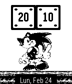

<!-- Generated by scripts/update_app_directory.py: do not edit by hand -->
[← All Pebble Developers](../developers.md)

# Duendiyo

*2 watchfaces · Last updated 2026-10-12 · [About these lists](../about-app-lists.md)*

Links: [Pebble App Store](https://apps.repebble.com/apps/dev/duendiyo_52e8f2c2dcc23cb26e000011) · [GitHub (shadone)](https://github.com/shadone)

<button type="button" data-filter="all" aria-pressed="true">All 2</button><button type="button" data-filter="watchface" aria-pressed="false">Watchfaces 2</button><button type="button" data-filter="watchapp" aria-pressed="false" disabled>Apps 0</button>

<label class="dev-sort">Sort by <select><option value="updated">Recently updated</option><option value="released">Newest release</option><option value="title">A–Z</option></select></label>

<h2 class="app-name" id="app-530bda91a81732cffb000036"><a href="https://apps.repebble.com/530bda91a81732cffb000036">Sonic Animated</a> v2</h2>
<a class="app-source" href="http://github.com/shadone/pebble-mario" title="Source code" data-search-exclude>View source</a>

Watchface

No licence Released 2014-02-24 Updated 2014-02-24

Runs on: Time 2, Pebble 2 Duo, Pebble 2, Time, Classic

the famous hedgehog ...: D based on the face originalde mario Denis, with its modified consent ...

<h2 class="app-name" id="app-52fc55692ace7afa920000cc"><a href="https://apps.repebble.com/52fc55692ace7afa920000cc">TQM v2</a> v2.0.0</h2>
<a class="app-source" href="http://small.cat/hat" title="Source code" data-search-exclude>View source</a>

Watchface

Released 2014-02-13 Updated 2014-02-14

Runs on: Time 2, Pebble 2 Duo, Pebble 2, Time, Classic

Que mas se le puede decir a la persona que amas...

