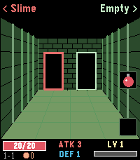

<!-- Generated by scripts/update_app_directory.py: do not edit by hand -->
[← All Pebble Developers](../developers.md)

# duke

*2 apps · Last updated 2026-10-12 · [About these lists](../about-app-lists.md)*

Links: [Pebble App Store](https://apps.repebble.com/apps/dev/duke_d48f949b70fcaefd4e29e5cb) · [GitHub (duke0815)](https://github.com/duke0815)

<button type="button" data-filter="all" aria-pressed="true">All 2</button><button type="button" data-filter="watchface" aria-pressed="false" disabled>Watchfaces 0</button><button type="button" data-filter="watchapp" aria-pressed="false">Apps 2</button>

<label class="dev-sort">Sort by <select><option value="updated">Recently updated</option><option value="released">Newest release</option><option value="title">A–Z</option></select></label>

<h2 class="app-name" id="app-2a6fe2cb878f4eb4ac9082fc"><a href="https://apps.repebble.com/2a6fe2cb878f4eb4ac9082fc">Dungeon Doors</a> v1.0.0</h2>
<a class="app-source" href="https://github.com/duke0815/pebble-dungeon" title="Source code" data-search-exclude>View source</a>

App

No licence Released 2026-10-01 Updated 2026-10-01

Runs on: Time 2

Left or right? A pocket roguelike for your wrist. Walk through three dungeons, one door at a time. Above each door you see what waits behind it: a chest, an empty room, the merchant – or a…

<h2 class="app-name" id="app-221aea7552c54e9a87277a29"><a href="https://apps.repebble.com/221aea7552c54e9a87277a29">Calendar for Office 365</a> v1.0.0</h2>
<a class="app-source" href="https://github.com/duke0815/pebble_calender_app" title="Source code" data-search-exclude>View source</a>

App

No licence Released 2026-10-01 Updated 2026-10-01

Runs on: Time 2, Pebble 2 Duo, Pebble 2, Time

Your Microsoft 365 and Outlook.com calendar on your wrist. DAY VIEW See all events of a day as clear cards with time, title and location. Swipe left and right to change the day on Pebble Time 2…

