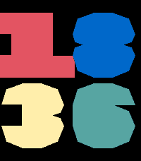

<!-- Generated by scripts/update_app_directory.py: do not edit by hand -->
[← All Pebble Developers](../developers.md)

# DuMe

*1 watchface · Last updated 2026-10-12 · [About these lists](../about-app-lists.md)*

Links: [Pebble App Store](https://apps.repebble.com/apps/dev/dume_5f16df93c8534300ec276ef4) · [GitHub (smndhm)](https://github.com/smndhm) · [Website (simon.duhem.fr)](https://simon.duhem.fr)

<h2 class="app-name" id="app-6a2a58c32a809d000935dd97"><a href="https://apps.repebble.com/6a2a58c32a809d000935dd97">Claude Fails</a> v0.1</h2>
<a class="app-source" href="https://github.com/smndhm/pebble" title="Source code" data-search-exclude>View source</a>

Watchface · <a href="https://forum.rebble.io/t/1043" title="Discuss this app on the Rebble forum" data-search-exclude>Forum thread</a>

Released 2026-06-11 Updated 2026-06-11

Runs on: Round 2, Time 2, Pebble 2 Duo, Pebble 2, Time Round, Time, Classic

A Pebble watchface born as a failed iteration on the road to &quot;World Cup 2026&quot;. While building &quot;World Cup 2026&quot; — a watchface using a custom typeface inspired by the World Cup 2026 typography — an…

