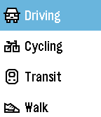

<!-- Generated by scripts/update_app_directory.py: do not edit by hand -->
[← All Pebble Developers](../developers.md)

# Dyedgreen

*1 app · Last updated 2026-10-11 · [About these lists](../about-app-lists.md)*

Links: [Rebble App Store](https://apps.rebble.io/en_US/developer/55740576f5c314a5f0000010/1) · [GitHub (Kuchenm0nster)](https://github.com/Kuchenm0nster)

<h2 class="app-name" id="app-576ee8e6ba2fe5a0c10000b9"><a href="https://apps.rebble.io/en_US/application/576ee8e6ba2fe5a0c10000b9">Directions</a> v1.9</h2>
<a class="app-source" href="https://github.com/Kuchenm0nster/pebble-directions" title="Source code" data-search-exclude>View source</a>

App

No licence Released 2016-06-25 Updated 2020-04-19 Rebble App Store

Runs on: Round 2, Time 2, Time Round, Time

Directions is a fast and simple navigation app. Select how you want to travel, speak your destination, and get a list of instructions that guide you there. Directions for cars, bicycles, public…

