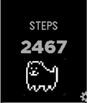

<!-- Generated by scripts/update_app_directory.py: do not edit by hand -->
[← All Pebble Developers](../developers.md)

# Dylan Bourgeois

*1 watchface and 1 app · Last updated 2026-10-12 · [About these lists](../about-app-lists.md)*

Links: [Pebble App Store](https://apps.repebble.com/apps/dev/dylan-bourgeois_52c6eba430db18908f000088) · [GitHub (dtsbourg)](https://github.com/dtsbourg)

<button type="button" data-filter="all" aria-pressed="true">All 2</button><button type="button" data-filter="watchface" aria-pressed="false">Watchfaces 1</button><button type="button" data-filter="watchapp" aria-pressed="false">Apps 1</button>

<label class="dev-sort">Sort by <select><option value="updated">Recently updated</option><option value="released">Newest release</option><option value="title">A–Z</option></select></label>

<h2 class="app-name" id="app-5820a0e1e7785b894200007f"><a href="https://apps.repebble.com/5820a0e1e7785b894200007f">Steps</a> v1.0</h2>
<a class="app-source" href="https://github.com/dtsbourg/steps" title="Source code" data-search-exclude>View source</a>

App

Other Released 2016-11-07 Updated 2016-11-07

Runs on: Time 2, Pebble 2 Duo, Pebble 2, Time, Classic

Introducing the DOGE coach, who will help you become a more active shibe !

<h2 class="app-name" id="app-52e4302a34ba660014000b9b"><a href="https://apps.repebble.com/52e4302a34ba660014000b9b">Doge</a> v1.0.0</h2>
<a class="app-source" href="https://github.com/dtsbourg/Doge/tree/master" title="Source code" data-search-exclude>View source</a>

Watchface

No licence Released 2014-01-25 Updated 2014-01-26

Runs on: Time 2, Pebble 2 Duo, Pebble 2, Time, Classic

Wow. Such watch face. Many Pebble. To the moon !

