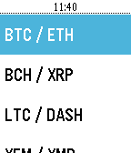

<!-- Generated by scripts/update_app_directory.py: do not edit by hand -->
[← All Pebble Developers](../developers.md)

# DylanGrl

*1 app · Last updated 2026-10-12 · [About these lists](../about-app-lists.md)*

Links: [Rebble App Store](https://apps.rebble.io/en_US/developer/58e3541c6ca387fc52000959/1) · [GitHub (DylanGrl)](https://github.com/DylanGrl) · [Website (dylangrl.github.io)](https://dylangrl.github.io/Pebble_CoinMarket/)

<h2 class="app-name" id="app-59ba7cad461a8dd989001bd7"><a href="https://apps.rebble.io/en_US/application/59ba7cad461a8dd989001bd7">CoinMarket</a> v1.0</h2>
<a class="app-source" href="https://github.com/DylanGrl/Pebble_CoinMarket" title="Source code" data-search-exclude>View source</a>

App

No licence Released 2017-09-14 Updated 2017-09-14 Rebble App Store

Runs on: Time 2, Pebble 2 Duo, Pebble 2, Time, Classic

Check easily the value and evolution of the top 10 cryptocurrency from coinmarketcap website. Easily change your fiat from the settings of the app in the phone ! (Feel free to donate for dev : BTC…

