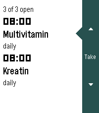
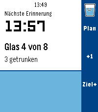

<!-- Generated by scripts/update_app_directory.py: do not edit by hand -->
[← All Pebble Developers](../developers.md)

# dysseus

*4 apps · Last updated 2026-10-12 · [About these lists](../about-app-lists.md)*

Links: [Pebble App Store](https://apps.repebble.com/apps/dev/dysseus_d55366949234e464067ed224) · [GitHub (dysseus-pascal)](https://github.com/dysseus-pascal)

<button type="button" data-filter="all" aria-pressed="true">All 4</button><button type="button" data-filter="watchface" aria-pressed="false" disabled>Watchfaces 0</button><button type="button" data-filter="watchapp" aria-pressed="false">Apps 4</button>

<label class="dev-sort">Sort by <select><option value="updated">Recently updated</option><option value="released">Newest release</option><option value="title">A–Z</option></select></label>

<h2 class="app-name" id="app-04848268a8b24e949f4eb832"><a href="https://apps.repebble.com/04848268a8b24e949f4eb832">SupCycle</a> v0.14.0</h2>
<a class="app-source" href="https://github.com/dysseus-pascal/SupCycle" title="Source code" data-search-exclude>View source</a>

App

CC0-1.0 Released 2026-09-23 Updated 2026-10-03

Runs on: Round 2, Time 2, Pebble 2 Duo

Präparate im Blick behalten: was heute ansteht, und wo die zyklischen gerade in ihrem Zyklus stehen. Die Oberfläche folgt der Sprache der Uhr (Deutsch und Englisch, Englisch als Rückfall) und dem…

<h2 class="app-name" id="app-e5b37daa64c24c5cbe11dd05"><a href="https://apps.repebble.com/e5b37daa64c24c5cbe11dd05">Drinktervall</a> v1.19.0</h2>
<a class="app-source" href="https://github.com/dysseus-pascal/Drinktervall" title="Source code" data-search-exclude>View source</a>

App

CC0-1.0 Released 2026-09-11 Updated 2026-10-03

Runs on: Round 2, Time 2, Pebble 2 Duo

Drinking reminder app with Timeline integration and a cute animation. Stay Hydrated my friends!

<h2 class="app-name" id="app-1f02276078b84a2e861d9e40"><a href="https://apps.repebble.com/1f02276078b84a2e861d9e40">Flynformer</a> v0.7.0</h2>
<a class="app-source" href="https://github.com/dysseus-pascal/Flynformer" title="Source code" data-search-exclude>View source</a>

App

CC0-1.0 Released 2026-09-14 Updated 2026-09-24

Runs on: Round 2, Time 2, Pebble 2 Duo

Type the flight number on the watch. No hunting through the phone app: two letters, up to four digits, done. It stays until you change it. Meet Flyn — your flight companion. Three pages, in the…

<h2 class="app-name" id="app-00e60e51de9047b68241bcb0"><a href="https://apps.repebble.com/00e60e51de9047b68241bcb0">ChronoKit</a> v1.4.0</h2>
<a class="app-source" href="https://github.com/dysseus-pascal/ChronoKit" title="Source code" data-search-exclude>View source</a>

App

Other Released 2026-09-10 Updated 2026-09-24

Runs on: Round 2, Time 2, Pebble 2 Duo

Stopwatch and Timer in one app

