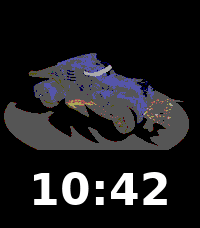

<!-- Generated by scripts/update_app_directory.py: do not edit by hand -->
[← All Pebble Developers](../developers.md)

# Dzmitry Malyshau

*1 watchface · Last updated 2026-10-12 · [About these lists](../about-app-lists.md)*

Links: [Pebble App Store](https://apps.repebble.com/apps/dev/dzmitry-malyshau_00a174b857287af42e3ed3c5) · [GitHub (kvark)](https://github.com/kvark)

<h2 class="app-name" id="app-4ae142201d714846a1fab3d7"><a href="https://apps.repebble.com/4ae142201d714846a1fab3d7">Van Face</a> v1.0.16</h2>
<a class="app-source" href="https://github.com/kvark/van-face" title="Source code" data-search-exclude>View source</a>

Watchface

Released 2026-06-02 Updated 2026-06-05

Runs on: Round 2, Time 2, Pebble 2 Duo, Pebble 2, Time Round, Time, Classic

Rotating Vangers mechos on a turntable, with the time below. Cycles through 14 vehicles (Iron Shadow to Excorps) by day, by wrist-raise/tap, or pinned via settings. Inspired by the in-game shop…

