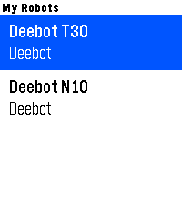
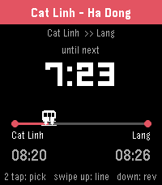

<!-- Generated by scripts/update_app_directory.py: do not edit by hand -->
[← All Pebble Developers](../developers.md)

# Dzung Nguyen

*2 apps · Last updated 2026-10-11 · [About these lists](../about-app-lists.md)*

Links: [Pebble App Store](https://apps.repebble.com/apps/dev/dzung-nguyen_953495be3bbba9424ed38e9b) · [GitHub (dungngminh)](https://github.com/dungngminh)

<button type="button" data-filter="all" aria-pressed="true">All 2</button><button type="button" data-filter="watchface" aria-pressed="false" disabled>Watchfaces 0</button><button type="button" data-filter="watchapp" aria-pressed="false">Apps 2</button>

<label class="dev-sort">Sort by <select><option value="updated">Recently updated</option><option value="released">Newest release</option><option value="title">A–Z</option></select></label>

<h2 class="app-name" id="app-319084c8494c44ae821ccee9"><a href="https://apps.repebble.com/319084c8494c44ae821ccee9">Vacuum</a> v1.1.1</h2>
<a class="app-source" href="https://github.com/dungngminh/pebble_vacuum" title="Source code" data-search-exclude>View source</a>

App

Released 2026-07-14 Updated 2026-07-14

Runs on: Round 2, Time 2, Pebble 2 Duo, Pebble 2, Time Round, Time, Classic

Put your robot vacuum on your wrist. Vacuum connects your Pebble watch to your robot&#x27;s cloud API, so you can check and control it without reaching for your phone. Built to grow — v1.0 supports…

<h2 class="app-name" id="app-e1f486d7efeb4d1a980d19e6"><a href="https://apps.repebble.com/e1f486d7efeb4d1a980d19e6">Metro VietNam</a> v1.2.0</h2>
<a class="app-source" href="https://github.com/dungngminh/pebble_metro_vietnam" title="Source code" data-search-exclude>View source</a>

App

Released 2026-06-27 Updated 2026-06-28

Runs on: Round 2, Time 2, Pebble 2 Duo, Pebble 2, Time Round, Time, Classic

Track Hanoi &amp; Ho Chi Minh City metro from your wrist. Pick your trip A → B, watch the next train count down, get a buzz before it arrives.

