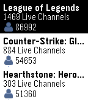

<!-- Generated by scripts/update_app_directory.py: do not edit by hand -->
[← All Pebble Developers](../developers.md)

# E. Poon &amp; I. Gollish

*1 app · Last updated 2026-10-11 · [About these lists](../about-app-lists.md)*

Links: [Pebble App Store](https://apps.repebble.com/apps/dev/e-poon-i-gollish_559605ae7f824311f10000d1) · [GitHub (navies)](https://github.com/navies)

<h2 class="app-name" id="app-5620481225ef793e5a00001a"><a href="https://apps.repebble.com/5620481225ef793e5a00001a">Twibble</a> v1.3</h2>
<a class="app-source" href="https://github.com/navies/Twibble/" title="Source code" data-search-exclude>View source</a>

App

Released 2015-10-16 Updated 2016-11-19

Runs on: Round 2, Time 2, Pebble 2 Duo, Pebble 2, Time Round, Time, Classic

Keep up to all your favorite streamers with Twibble, the Twitch Pebble app! Features include: - Checking which of your followed streamers is online by signing in through app settings on your phone…

