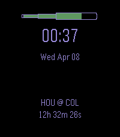

<!-- Generated by scripts/update_app_directory.py: do not edit by hand -->
[← All Pebble Developers](../developers.md)

# Ebenezer Development

*1 watchface · Last updated 2026-10-12 · [About these lists](../about-app-lists.md)*

Links: [Pebble App Store](https://apps.repebble.com/apps/dev/ebenezer-development_9773f1c076f0525e423e32fe) · [GitHub (treverjohnston)](https://github.com/treverjohnston)

<h2 class="app-name" id="app-6cce984be2de40baa07d4785"><a href="https://apps.repebble.com/6cce984be2de40baa07d4785">Baseball Countdown</a> v1.0</h2>
<a class="app-source" href="https://github.com/treverjohnston/pebbleMLB" title="Source code" data-search-exclude>View source</a>

Watchface

Released 2026-04-08 Updated 2026-04-08

Runs on: Round 2, Time 2

A basic watchface that counts down to the game time of your favorite MLB team. Complete with baseball &#x27;bat&#x27;-tery bar. Once a game starts, countdown converts to updating score.

