<!-- Generated by scripts/update_app_directory.py: do not edit by hand -->
[← All Pebble Developers](../developers.md)

# EC Apps

*16 watchfaces and 3 apps · Last updated 2026-10-12 · [About these lists](../about-app-lists.md)*

Links: [Pebble App Store](https://apps.repebble.com/apps/dev/ec-apps_6818b3bd53899000082d25a4) · [GitHub (eduardochiaro)](https://github.com/eduardochiaro) · [Website (eduardochiaro.com)](https://www.eduardochiaro.com)

<button type="button" data-filter="all" aria-pressed="true">All 19</button><button type="button" data-filter="watchface" aria-pressed="false">Watchfaces 16</button><button type="button" data-filter="watchapp" aria-pressed="false">Apps 3</button>

<label class="dev-sort">Sort by <select><option value="updated">Recently updated</option><option value="released">Newest release</option><option value="title">A–Z</option></select></label>

<h2 class="app-name" id="app-6abf59c037b3780009304810"><a href="https://apps.repebble.com/6abf59c037b3780009304810">Ultra</a> v1.9.0</h2>
<a class="app-source" href="https://github.com/eduardochiaro/ultra-watchface" title="Source code" data-search-exclude>View source</a>

Watchface · <a href="https://forum.rebble.io/t/1398" title="Discuss this app on the Rebble forum" data-search-exclude>Forum thread</a>

No licence Released 2026-10-02 Updated 2026-10-11

Runs on: Round 2, Time 2

An analog watchface for Pebble with eight complications you choose yourself. Four gauges curve around the corners, four subdials sit inside the dial, and every one is yours to swap. - Eight slots…

<h2 class="app-name" id="app-6aae5837cf733a0009498c16"><a href="https://apps.repebble.com/6aae5837cf733a0009498c16">Wristcards</a> v1.0.0</h2>
<a class="app-source" href="https://github.com/eduardochiaro/wristcards" title="Source code" data-search-exclude>View source</a>

App · <a href="https://forum.rebble.io/t/1370" title="Discuss this app on the Rebble forum" data-search-exclude>Forum thread</a>

MIT Released 2026-09-19 Updated 2026-09-19

Runs on: Round 2, Time 2

One Pebble watchapp for vocabulary drills, with the deck chosen on the phone. Dutch, French, German, Italian and Spanish are ready-made; any text file of cards will do. Load the app and use…

<h2 class="app-name" id="app-6a98f3c7039ea900095fe2da"><a href="https://apps.repebble.com/6a98f3c7039ea900095fe2da">Unpack</a> v1.1.0</h2>
<a class="app-source" href="https://github.com/eduardochiaro/unpack-watchapp" title="Source code" data-search-exclude>View source</a>

App · <a href="https://forum.rebble.io/t/1320" title="Discuss this app on the Rebble forum" data-search-exclude>Forum thread</a>

No licence Released 2026-09-03 Updated 2026-09-03

Runs on: Round 2, Time 2, Pebble 2 Duo, Pebble 2, Time Round, Time

A von Neumann probe game for Pebble. You arrive in an uncharted system with a seed payload and no infrastructure. Unpack yourself into power and extraction, work the bodies you find, and build…

<a class="app-shot" href="https://apps.repebble.com/6a3d4248cd52370009862b05" data-search-exclude>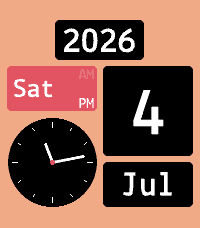</a>

<h2 class="app-name" id="app-6a3d4248cd52370009862b05"><a href="https://apps.repebble.com/6a3d4248cd52370009862b05">Wall Flip</a> v3.3.0</h2>
<a class="app-source" href="https://github.com/eduardochiaro/flipwall-watchface" title="Source code" data-search-exclude>View source</a>

Watchface · <a href="https://forum.rebble.io/t/1086" title="Discuss this app on the Rebble forum" data-search-exclude>Forum thread</a>

No licence Released 2026-06-25 Updated 2026-08-05

Runs on: Round 2, Time 2, Pebble 2 Duo, Pebble 2, Time Round, Time, Classic

A digital watchface based on flip clock design. Configure via the settings page. General Layout: 5 or 6 blocks. Language — translates month and weekday names. 10 Latin-script languages: English…

<a class="app-shot" href="https://apps.repebble.com/694a99bbfb639a000a570b91" data-search-exclude>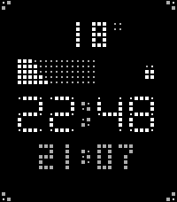</a>

<h2 class="app-name" id="app-694a99bbfb639a000a570b91"><a href="https://apps.repebble.com/694a99bbfb639a000a570b91">GridSpace</a> v1.7.0</h2>
<a class="app-source" href="https://github.com/eduardochiaro/gridspace" title="Source code" data-search-exclude>View source</a>

Watchface · <a href="https://forum.rebble.io/t/342" title="Discuss this app on the Rebble forum" data-search-exclude>Forum thread</a>

No licence Released 2025-12-23 Updated 2026-07-25

Runs on: Round 2, Time 2, Pebble 2 Duo, Pebble 2, Time Round, Time, Classic

A minimalist Pebble watchface with a distinctive pixel-grid aesthetic. Time, Date, Step Tracker, Weather and Battery Indicator. Access settings through the Pebble app: - Color Options: Background…

<a class="app-shot" href="https://apps.repebble.com/6974c01b8b7ed80009421835" data-search-exclude>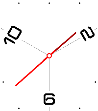</a>

<h2 class="app-name" id="app-6974c01b8b7ed80009421835"><a href="https://apps.repebble.com/6974c01b8b7ed80009421835">Simple Trio</a> v1.4.0</h2>
<a class="app-source" href="https://github.com/eduardochiaro/simple-trio" title="Source code" data-search-exclude>View source</a>

Watchface · <a href="https://forum.rebble.io/t/554" title="Discuss this app on the Rebble forum" data-search-exclude>Forum thread</a>

No licence Released 2026-01-24 Updated 2026-07-23

Runs on: Round 2, Time 2, Pebble 2 Duo, Pebble 2, Time Round, Time, Classic

A minimalist analog watchface for Pebble smartwatches inspired by clean, modern clock design.

<a class="app-shot" href="https://apps.repebble.com/6960135be386d90009527f25" data-search-exclude>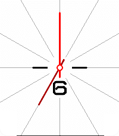</a>

<h2 class="app-name" id="app-6960135be386d90009527f25"><a href="https://apps.repebble.com/6960135be386d90009527f25">Simple Enough</a> v1.5.0</h2>
<a class="app-source" href="https://github.com/eduardochiaro/simple-enough" title="Source code" data-search-exclude>View source</a>

Watchface · <a href="https://forum.rebble.io/t/462" title="Discuss this app on the Rebble forum" data-search-exclude>Forum thread</a>

No licence Released 2026-01-08 Updated 2026-07-23

Runs on: Round 2, Time 2, Pebble 2 Duo, Pebble 2, Time Round, Time, Classic

A minimalist analog watchface for Pebble smartwatches inspired by clean, modern clock design.

<a class="app-shot" href="https://apps.repebble.com/6980f66ae145ac00097cbaa4" data-search-exclude>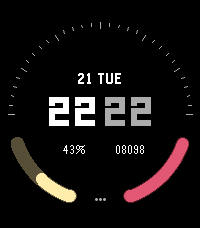</a>

<h2 class="app-name" id="app-6980f66ae145ac00097cbaa4"><a href="https://apps.repebble.com/6980f66ae145ac00097cbaa4">Dual Arc</a> v1.1.0</h2>
<a class="app-source" href="https://github.com/eduardochiaro/dual-arc" title="Source code" data-search-exclude>View source</a>

Watchface · <a href="https://forum.rebble.io/t/601" title="Discuss this app on the Rebble forum" data-search-exclude>Forum thread</a>

No licence Released 2026-02-02 Updated 2026-07-21

Runs on: Round 2, Time 2, Pebble 2 Duo, Pebble 2, Time Round, Time, Classic

A modern digital watchface combining style and functionality. Features include large split time display (hours/minutes), date with weekday, dual quarter-circle progress indicators for battery and…

<a class="app-shot" href="https://apps.repebble.com/6a5609cec5fa78000971594e" data-search-exclude>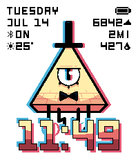</a>

<h2 class="app-name" id="app-6a5609cec5fa78000971594e"><a href="https://apps.repebble.com/6a5609cec5fa78000971594e">Bill Cipher is Watching You</a> v1.2.0</h2>
<a class="app-source" href="https://github.com/eduardochiaro/cipher-watchface" title="Source code" data-search-exclude>View source</a>

Watchface · <a href="https://forum.rebble.io/t/1153" title="Discuss this app on the Rebble forum" data-search-exclude>Forum thread</a>

No licence Released 2026-07-14 Updated 2026-07-16

Runs on: Round 2, Time 2, Pebble 2 Duo, Pebble 2, Time Round, Time, Classic

A-X-O-L-O-T-L! My time has come to burn! I invoke the ancient power that I may return! Nice watchface designed to bring Bill Cipher with you everyday. Configurations: - Time Color: pick color or…

<a class="app-shot" href="https://apps.repebble.com/69da689d804ae2000901d42b" data-search-exclude>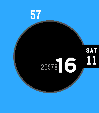</a>

<h2 class="app-name" id="app-69da689d804ae2000901d42b"><a href="https://apps.repebble.com/69da689d804ae2000901d42b">Void</a> v2.1.0</h2>
<a class="app-source" href="https://github.com/eduardochiaro/void" title="Source code" data-search-exclude>View source</a>

Watchface · <a href="https://forum.rebble.io/t/853" title="Discuss this app on the Rebble forum" data-search-exclude>Forum thread</a>

No licence Released 2026-04-11 Updated 2026-06-04

Runs on: Round 2, Time 2

A sleek and minimalist watch face made with Alloy that displays only the time, date, and steps (if active). The accent color can be customized.

<a class="app-shot" href="https://apps.repebble.com/69a412a94c5ae70009a92597" data-search-exclude>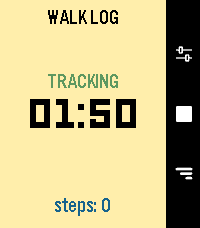</a>

<h2 class="app-name" id="app-69a412a94c5ae70009a92597"><a href="https://apps.repebble.com/69a412a94c5ae70009a92597">Walk Log</a> v1.12.0</h2>
<a class="app-source" href="https://github.com/eduardochiaro/walk-log" title="Source code" data-search-exclude>View source</a>

App · <a href="https://forum.rebble.io/t/725" title="Discuss this app on the Rebble forum" data-search-exclude>Forum thread</a>

No licence Released 2026-03-01 Updated 2026-05-23

Runs on: Round 2, Time 2, Pebble 2 Duo, Pebble 2, Time Round, Time, Classic

Walk Log is a Pebble application that tracks the time and steps taken during your walks. Your walk history is stored in the logs view, where you can review past activities and delete entries as…

<a class="app-shot" href="https://apps.repebble.com/69fa46f9ea28ba00099a6c61" data-search-exclude>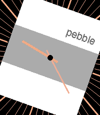</a>

<h2 class="app-name" id="app-69fa46f9ea28ba00099a6c61"><a href="https://apps.repebble.com/69fa46f9ea28ba00099a6c61">Simple Askew</a> v1.1.0</h2>
<a class="app-source" href="https://github.com/eduardochiaro/simple-collection/tree/main/askew" title="Source code" data-search-exclude>View source</a>

Watchface · <a href="https://forum.rebble.io/t/952" title="Discuss this app on the Rebble forum" data-search-exclude>Forum thread</a>

No licence Released 2026-05-05 Updated 2026-05-05

Runs on: Round 2, Time 2, Pebble 2 Duo, Pebble 2, Time Round, Time, Classic

A minimalist analog watchface, just a little askew. You can change the degree in settings: 0,10,15,20,25 or 30 degrees.

<a class="app-shot" href="https://apps.repebble.com/69f5bdbc8fdda50008c81da4" data-search-exclude>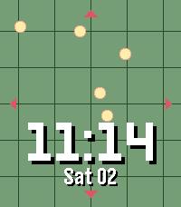</a>

<h2 class="app-name" id="app-69f5bdbc8fdda50008c81da4"><a href="https://apps.repebble.com/69f5bdbc8fdda50008c81da4">Dragon Radar</a> v1.1.0</h2>
<a class="app-source" href="https://github.com/eduardochiaro/dragon-radar-watchface" title="Source code" data-search-exclude>View source</a>

Watchface · <a href="https://forum.rebble.io/t/935" title="Discuss this app on the Rebble forum" data-search-exclude>Forum thread</a>

No licence Released 2026-05-02 Updated 2026-05-02

Runs on: Round 2, Time 2, Pebble 2 Duo, Pebble 2, Time Round, Time, Classic

A Pebble watchface inspired by Dragon Radar in Dragon Ball. Every minute the radar update showing a random position of the Dragon Balls 2 radar styles, choose one from configuration.

<h2 class="app-name" id="app-698e41f7ea64380009df8ecc"><a href="https://apps.repebble.com/698e41f7ea64380009df8ecc">Half/Half</a> v1.6</h2>
<a class="app-source" href="https://github.com/eduardochiaro/half-half" title="Source code" data-search-exclude>View source</a>

Watchface · <a href="https://forum.rebble.io/t/648" title="Discuss this app on the Rebble forum" data-search-exclude>Forum thread</a>

No licence Released 2026-02-12 Updated 2026-04-26

Runs on: Round 2, Time 2, Pebble 2 Duo, Pebble 2, Time Round, Time, Classic

A digital watchface for Pebble smartwatches with a minimalist split-screen design. Configs: - Top Color/Bottom Color - Override Text Color - Show Seconds - Show Leading Zero - Battery saving: hide…

<a class="app-shot" href="https://apps.repebble.com/69d01934afd8430009d9a1e8" data-search-exclude>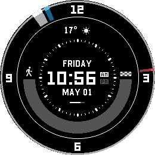</a>

<h2 class="app-name" id="app-69d01934afd8430009d9a1e8"><a href="https://apps.repebble.com/69d01934afd8430009d9a1e8">Constellation - Chronomark Edition</a> v3.3</h2>
<a class="app-source" href="https://github.com/eduardochiaro/constellation" title="Source code" data-search-exclude>View source</a>

Watchface

No licence Released 2026-04-03 Updated 2026-04-11

Runs on: Round 2

Take a trip to the stars with this Starfield-inspired watchface. Chronomark Edition, just for Pebble Time Round 2 Features - Time Display: Large, easy-to-read time with day, date, and AM/PM…

<a class="app-shot" href="https://apps.repebble.com/695299cfda150100090722b8" data-search-exclude>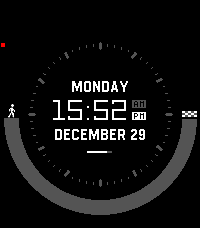</a>

<h2 class="app-name" id="app-695299cfda150100090722b8"><a href="https://apps.repebble.com/695299cfda150100090722b8">Constellation - Standard Edition</a> v2.7</h2>
<a class="app-source" href="https://github.com/eduardochiaro/constellation" title="Source code" data-search-exclude>View source</a>

Watchface · <a href="https://forum.rebble.io/t/384" title="Discuss this app on the Rebble forum" data-search-exclude>Forum thread</a>

No licence Released 2025-12-29 Updated 2026-04-04

Runs on: Round 2, Time 2, Pebble 2 Duo, Pebble 2, Time Round, Time, Classic

Take a trip to the stars with this Starfield-inspired watchface. It works best for the Pebble Time Round. Features - Time Display: Large, easy-to-read time with day, date, and AM/PM indicators …

<a class="app-shot" href="https://apps.repebble.com/6978ff6c047265000996d297" data-search-exclude>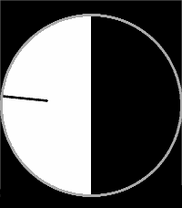</a>

<h2 class="app-name" id="app-6978ff6c047265000996d297"><a href="https://apps.repebble.com/6978ff6c047265000996d297">Simple Binary</a> v1.0</h2>
<a class="app-source" href="https://github.com/eduardochiaro/simple-collection/tree/main/binary" title="Source code" data-search-exclude>View source</a>

Watchface · <a href="https://forum.rebble.io/t/579" title="Discuss this app on the Rebble forum" data-search-exclude>Forum thread</a>

No licence Released 2026-01-27 Updated 2026-01-27

Runs on: Round 2, Time 2, Pebble 2 Duo, Pebble 2, Time Round, Time, Classic

A minimal Pebble watchface that progressively fills the screen radially based on the hour. At 00:00 the screen is completely black, gradually becoming white until 12:00, then fading back to black…

<a class="app-shot" href="https://apps.repebble.com/6974a40065b98f00098a7cf9" data-search-exclude>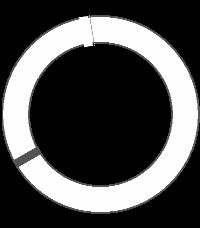</a>

<h2 class="app-name" id="app-6974a40065b98f00098a7cf9"><a href="https://apps.repebble.com/6974a40065b98f00098a7cf9">Simple Eclipse</a> v1.0</h2>
<a class="app-source" href="https://github.com/eduardochiaro/simple-eclipse" title="Source code" data-search-exclude>View source</a>

Watchface · <a href="https://forum.rebble.io/t/553" title="Discuss this app on the Rebble forum" data-search-exclude>Forum thread</a>

No licence Released 2026-01-24 Updated 2026-01-24

Runs on: Round 2, Time 2, Pebble 2 Duo, Pebble 2, Time Round, Time, Classic

A minimal Pebble watchface designed to look like an eclipse.

<a class="app-shot" href="https://apps.repebble.com/68190b36404fff0009e209bb" data-search-exclude>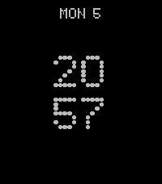</a>

<h2 class="app-name" id="app-68190b36404fff0009e209bb"><a href="https://apps.repebble.com/68190b36404fff0009e209bb">It&#x27;s Nothing</a> v2.6</h2>
<a class="app-source" href="https://github.com/eduardochiaro/its-nothing" title="Source code" data-search-exclude>View source</a>

Watchface

No licence Released 2025-05-05 Updated 2025-11-16

Runs on: Round 2, Time 2, Pebble 2 Duo, Pebble 2, Time Round, Time, Classic

This Pebble watchface, inspired by NothingOS by Nothing Technology Limited, is still in the construction phase. Feedback is highly appreciated. Users can modify the following settings: - Modules …

