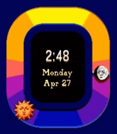

<!-- Generated by scripts/update_app_directory.py: do not edit by hand -->
[← All Pebble Developers](../developers.md)

# EchoLalia

*1 watchface · Last updated 2026-10-11 · [About these lists](../about-app-lists.md)*

Links: [Pebble App Store](https://apps.repebble.com/apps/dev/echolalia_10533604cb53ab9af777b71c) · [GitHub (echo-lalia)](https://github.com/echo-lalia)

<h2 class="app-name" id="app-27ea2cc229cd49b0bfc573be"><a href="https://apps.repebble.com/27ea2cc229cd49b0bfc573be">Celestial Noon</a> v1.5</h2>
<a class="app-source" href="https://github.com/echo-lalia/celestialnoon" title="Source code" data-search-exclude>View source</a>

Watchface

Released 2026-04-20 Updated 2026-06-08

Runs on: Round 2, Time 2, Pebble 2 Duo, Pebble 2, Time Round, Time, Classic

A watch face inspired by the &quot;Celestial Whimsy&quot; aesthetic, where the clock hands have been replaced with a live visualization of the sun and moon rising and setting. At solar noon, the sun will…

