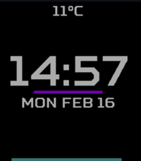
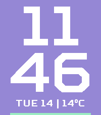

<!-- Generated by scripts/update_app_directory.py: do not edit by hand -->
[← All Pebble Developers](../developers.md)

# EdBo

*2 watchfaces · Last updated 2026-10-11 · [About these lists](../about-app-lists.md)*

Links: [Pebble App Store](https://apps.repebble.com/apps/dev/edbo_691362a12d597b00093f3a48) · [GitHub (beatles1)](https://github.com/beatles1)

<button type="button" data-filter="all" aria-pressed="true">All 2</button><button type="button" data-filter="watchface" aria-pressed="false">Watchfaces 2</button><button type="button" data-filter="watchapp" aria-pressed="false" disabled>Apps 0</button>

<label class="dev-sort">Sort by <select><option value="updated">Recently updated</option><option value="released">Newest release</option><option value="title">A–Z</option></select></label>

<h2 class="app-name" id="app-30059ade40e44f408302f543"><a href="https://apps.repebble.com/30059ade40e44f408302f543">Clean</a> v0.7</h2>
<a class="app-source" href="https://github.com/beatles1/PebbleClean/" title="Source code" data-search-exclude>View source</a>

Watchface · <a href="https://forum.rebble.io/t/667" title="Discuss this app on the Rebble forum" data-search-exclude>Forum thread</a>

No licence Released 2026-02-16 Updated 2026-05-02

Runs on: Time 2, Time

Simple digital watchface with: - Temperature from Open Weather Map - Bar showing percentage of health target achieved - Bar showing battery level Colours of bars are customisable via settings as…

<h2 class="app-name" id="app-6f06beee0a71423dba3bf84d"><a href="https://apps.repebble.com/6f06beee0a71423dba3bf84d">Purple</a> v0.2</h2>
<a class="app-source" href="https://github.com/beatles1/PebblePurple" title="Source code" data-search-exclude>View source</a>

Watchface

No licence Released 2026-04-14 Updated 2026-04-14

Runs on: Time 2

Simple digital watchface with: - Temperature from Open Meteo - Bar showing battery level at bottom of screen - Customsable colours (despite the name) as well as settings to disable temperature and…

