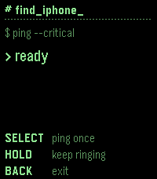

<!-- Generated by scripts/update_app_directory.py: do not edit by hand -->
[← All Pebble Developers](../developers.md)

# Eddie Baker

*2 apps · Last updated 2026-11-02 · [About these lists](../about-app-lists.md)*

Links: [Pebble App Store](https://apps.repebble.com/apps/dev/eddie-baker_4ab6bb8c21d08402039dcd0b) · [GitHub (eddieatjollyroger)](https://github.com/eddieatjollyroger)

<button type="button" data-filter="all" aria-pressed="true">All 2</button><button type="button" data-filter="watchface" aria-pressed="false" disabled>Watchfaces 0</button><button type="button" data-filter="watchapp" aria-pressed="false">Apps 2</button>

<label class="dev-sort">Sort by <select><option value="updated">Recently updated</option><option value="released">Newest release</option><option value="title">A–Z</option></select></label>

<h2 class="app-name" id="app-370aee7508844929b822e0cc"><a href="https://apps.repebble.com/370aee7508844929b822e0cc">HA Ping my iPhone</a> v1.0.0</h2>
<a class="app-source" href="https://github.com/eddieatjollyroger/PebblePingMyiPhone" title="Source code" data-search-exclude>View source</a>

App

No licence Released 2026-10-24 Updated 2026-10-24

Runs on: Round 2, Time 2, Pebble 2 Duo, Pebble 2, Time Round, Time, Classic

Uses Home Assistant&#x27;s notify service to send a critical alert ringing an iPhone even in Silent Mode to locate it instead of using Apple&#x27;s Find My service.

<h2 class="app-name" id="app-da1745a953be4aabbf069ff6"><a href="https://apps.repebble.com/da1745a953be4aabbf069ff6">HA TV Remote</a> v1.1</h2>
<a class="app-source" href="https://github.com/eddieatjollyroger/Pebble-HA-TV-Remote" title="Source code" data-search-exclude>View source</a>

App

No licence Released 2026-10-19 Updated 2026-10-23

Runs on: Round 2, Time 2, Pebble 2 Duo, Pebble 2, Time Round, Time, Classic

A remote for all Home Assistant TVs. It works with Apple TV, Android TV (through the Android TV Remote integration) and VIDAA TVs (through the Vidaa TV integration). Button Select: sends an OK…

