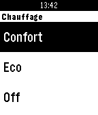

<!-- Generated by scripts/update_app_directory.py: do not edit by hand -->
[← All Pebble Developers](../developers.md)

# Edouard Kleinhans

*1 app · Last updated 2026-10-11 · [About these lists](../about-app-lists.md)*

Links: [Pebble App Store](https://apps.repebble.com/apps/dev/edouard-kleinhans_55d98b88dd7776a73e000079) · [GitHub (edouardkleinhans)](https://github.com/edouardkleinhans)

<h2 class="app-name" id="app-56a49e1711d0acdd4700002a"><a href="https://apps.repebble.com/56a49e1711d0acdd4700002a">Jebble</a> v1.3</h2>
<a class="app-source" href="https://github.com/edouardkleinhans/jebble_watchapp" title="Source code" data-search-exclude>View source</a>

App

Released 2016-01-24 Updated 2016-11-03

Runs on: Round 2, Time 2, Pebble 2 Duo, Pebble 2, Time Round, Time, Classic

Plugin pour permettre à votre montre Pebble de contrôler Jeedom (www.jeedom.fr)

