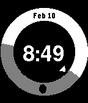

<!-- Generated by scripts/update_app_directory.py: do not edit by hand -->
[← All Pebble Developers](../developers.md)

# Edward Peek

*1 watchface · Last updated 2026-10-11 · [About these lists](../about-app-lists.md)*

Links: [Pebble App Store](https://apps.repebble.com/apps/dev/edward-peek_52f9cdb957e7c27b29000137) · [GitHub (edpenz)](https://github.com/edpenz) · [Website (edpe.nz)](https://edpe.nz/software/solar)

<h2 class="app-name" id="app-52f9da3f260ca5d3ab000135"><a href="https://apps.repebble.com/52f9da3f260ca5d3ab000135">Solar</a> v1.0.0</h2>
<a class="app-source" href="https://github.com/edpenz/solar" title="Source code" data-search-exclude>View source</a>

Watchface

Released 2014-02-11 Updated 2014-02-13

Runs on: Time 2, Pebble 2 Duo, Pebble 2, Time, Classic

Is it day? Is it night? Now -you- can find out! By utilising billions of dollars&#x27; worth of infrastructure, the Solar watch face now lets you answer this difficult question. iPhone users: You may…

