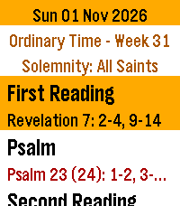
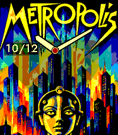
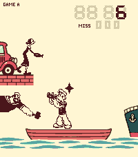
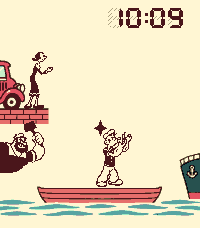
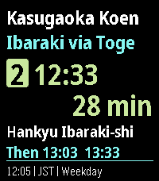

<!-- Generated by scripts/update_app_directory.py: do not edit by hand -->
[← All Pebble Developers](../developers.md)

# Edward

*2 watchfaces and 4 apps · Last updated 2026-10-12 · [About these lists](../about-app-lists.md)*

Links: [Pebble App Store](https://apps.repebble.com/apps/dev/edward_c476f03f63cabb0964fbce2e) · [GitHub (ewijaya)](https://github.com/ewijaya)

<button type="button" data-filter="all" aria-pressed="true">All 6</button><button type="button" data-filter="watchface" aria-pressed="false">Watchfaces 2</button><button type="button" data-filter="watchapp" aria-pressed="false">Apps 4</button>

<label class="dev-sort">Sort by <select><option value="updated">Recently updated</option><option value="released">Newest release</option><option value="title">A–Z</option></select></label>

<h2 class="app-name" id="app-9e466762014d4b1ab248219f"><a href="https://apps.repebble.com/9e466762014d4b1ab248219f">Roman Missal</a> v1.4.3</h2>
<a class="app-source" href="https://github.com/ewijaya/pebble-daily-mass" title="Source code" data-search-exclude>View source</a>

App

No licence Released 2026-10-08 Updated 2026-10-12

Runs on: Time 2

A worn cover. A ribbon left between the pages. The familiar red words that once helped us find our place. A missal can carry the memory of years spent in prayer, and of the people who sat beside…

<h2 class="app-name" id="app-a4aba1597dde497dbb3b66b3"><a href="https://apps.repebble.com/a4aba1597dde497dbb3b66b3">CINÉ</a> v1.5.0</h2>
<a class="app-source" href="https://github.com/ewijaya/pebble-cine" title="Source code" data-search-exclude>View source</a>

Watchface

No licence Released 2026-10-09 Updated 2026-10-11

Runs on: Time 2

CINÉ: Cinema on Your Wrist Some films keep their own time. Two hours in a dark room can stay with us for decades. We watch the same scene years later, and it hasn&#x27;t changed. We have. I can forget…

<h2 class="app-name" id="app-e9cb2950ca21440798fb1db8"><a href="https://apps.repebble.com/e9cb2950ca21440798fb1db8">Popeye G&amp;W</a> v1.6.0</h2>
<a class="app-source" href="https://github.com/ewijaya/popeye-gw" title="Source code" data-search-exclude>View source</a>

App

MIT Released 2026-10-05 Updated 2026-10-08

Runs on: Time 2

A whole childhood on one small screen. There was a time when a whole afternoon could fit in your hands. A little boat, a few black shapes, and the solemn promise that this would be your last game…

<h2 class="app-name" id="app-8e8e130581e7467d9d7b0138"><a href="https://apps.repebble.com/8e8e130581e7467d9d7b0138">Popeye G&amp;W Clock</a> v1.2.0</h2>
<a class="app-source" href="https://github.com/ewijaya/popeye-gw" title="Source code" data-search-exclude>View source</a>

Watchface

MIT Released 2026-10-06 Updated 2026-10-07

Runs on: Time 2

Old-school charm. Right on time. Popeye G&amp;W Clock is a nostalgic LCD watchface with an active harbour scene. Olive Oyl throws, Popeye moves and catches, and Brutus joins the action in crisp…

<h2 class="app-name" id="app-f63e6ed24301414a95909564"><a href="https://apps.repebble.com/f63e6ed24301414a95909564">KasugaBus</a> v2.2.2</h2>
<a class="app-source" href="https://github.com/ewijaya/kasugabus-pebble" title="Source code" data-search-exclude>View source</a>

App

No licence Released 2026-10-01 Updated 2026-10-02

Runs on: Time 2

Local buses for Minami-kasugaoka, Ibaraki, Osaka, Japan. KasugaBus shows the next scheduled Kintetsu and Hankyu buses at eight stops around Minami-kasugaoka: Kasugaoka Koen, Toge, Midorigaoka…

<h2 class="app-name" id="app-9882f741750c43eb8309777e"><a href="https://apps.repebble.com/9882f741750c43eb8309777e">Orationes</a> v0.14.0</h2>
<a class="app-source" href="https://github.com/ewijaya/pebble-orationes" title="Source code" data-search-exclude>View source</a>

App

No licence Released 2026-09-03 Updated 2026-09-30

Runs on: Time 2

Make time for prayer. On your wrist. Available offline. Orationes is a Catholic prayer book for Pebble Time 2. Large text and clear contrast help you focus on the words. Your prayers stay on your…

