<!-- Generated by scripts/update_app_directory.py: do not edit by hand -->
[← All Pebble Developers](../developers.md)

# Edwin Finch

*18 watchfaces · Last updated 2026-10-12 · [About these lists](../about-app-lists.md)*

Links: [Rebble App Store](https://apps.rebble.io/en_US/developer/5db6f59e385af50001ba25f9/1) · [GitHub (edwinfinch)](https://github.com/edwinfinch) · [Website (edwinfinch.com)](https://edwinfinch.com/redirect/pebble)

<button type="button" data-filter="all" aria-pressed="true">All 18</button><button type="button" data-filter="watchface" aria-pressed="false">Watchfaces 18</button><button type="button" data-filter="watchapp" aria-pressed="false" disabled>Apps 0</button>

<label class="dev-sort">Sort by <select><option value="updated">Recently updated</option><option value="released">Newest release</option><option value="title">A–Z</option></select></label>

<h2 class="app-name" id="app-5634363f396cf4a5da00004c"><a href="https://apps.rebble.io/en_US/application/5634363f396cf4a5da00004c">UpsideDown</a> v2.7-rbl</h2>
<a class="app-source" href="https://edwinfinch.com/redirect/pebble-legacy-source" title="Source code" data-search-exclude>View source</a>

Watchface

Released 2015-10-31 Updated 2021-06-17 Rebble App Store

Runs on: Round 2, Time 2, Pebble 2 Duo, Pebble 2, Time Round, Time, Classic

An old classic from our original collection from 2014-2016, now free &amp; open source!

<h2 class="app-name" id="app-55992f97bec20eb7b5000038"><a href="https://apps.rebble.io/en_US/application/55992f97bec20eb7b5000038">Timezones</a> v2.5-rbl</h2>
<a class="app-source" href="https://edwinfinch.com/redirect/pebble-legacy-source" title="Source code" data-search-exclude>View source</a>

Watchface

Released 2015-07-05 Updated 2021-06-17 Rebble App Store

Runs on: Time 2, Pebble 2 Duo, Pebble 2, Time, Classic

An old classic from our original collection from 2014-2016, now free &amp; open source!

<a class="app-shot" href="https://apps.rebble.io/en_US/application/556dcfbc354a41c220000011" data-search-exclude>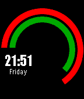</a>

<h2 class="app-name" id="app-556dcfbc354a41c220000011"><a href="https://apps.rebble.io/en_US/application/556dcfbc354a41c220000011">Speedometer</a> v2.5-rbl</h2>
<a class="app-source" href="https://edwinfinch.com/redirect/pebble-legacy-source" title="Source code" data-search-exclude>View source</a>

Watchface

Released 2015-06-02 Updated 2021-06-17 Rebble App Store

Runs on: Round 2, Time 2, Pebble 2 Duo, Pebble 2, Time Round, Time, Classic

An old classic from our original collection from 2014-2016, now free &amp; open source!

<a class="app-shot" href="https://apps.rebble.io/en_US/application/559c557e12dc3229e5000084" data-search-exclude>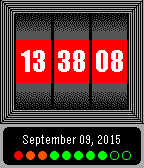</a>

<h2 class="app-name" id="app-559c557e12dc3229e5000084"><a href="https://apps.rebble.io/en_US/application/559c557e12dc3229e5000084">Slot Machine</a> v2.8-rbl</h2>
<a class="app-source" href="https://edwinfinch.com/redirect/pebble-legacy-source" title="Source code" data-search-exclude>View source</a>

Watchface

Released 2015-07-07 Updated 2021-06-17 Rebble App Store

Runs on: Time 2, Pebble 2 Duo, Pebble 2, Time, Classic

An old classic from our original collection from 2014-2016, now free &amp; open source! Slot Machine is an original face which emulates the style of an actual slot machine - watch the numbers of…

<a class="app-shot" href="https://apps.rebble.io/en_US/application/55b517ee46a407265f00007b" data-search-exclude>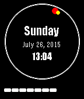</a>

<h2 class="app-name" id="app-55b517ee46a407265f00007b"><a href="https://apps.rebble.io/en_US/application/55b517ee46a407265f00007b">Simplified Analogue</a> v2.5-rbl</h2>
<a class="app-source" href="https://edwinfinch.com/redirect/pebble-legacy-source" title="Source code" data-search-exclude>View source</a>

Watchface

Released 2015-07-26 Updated 2021-06-17 Rebble App Store

Runs on: Time 2, Pebble 2 Duo, Pebble 2, Time, Classic

An old classic from our original collection from 2014-2016, now free &amp; open source!

<a class="app-shot" href="https://apps.rebble.io/en_US/application/567aebc885f00fee8e000039" data-search-exclude>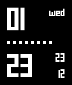</a>

<h2 class="app-name" id="app-567aebc885f00fee8e000039"><a href="https://apps.rebble.io/en_US/application/567aebc885f00fee8e000039">Simple Squares</a> v2.3-rbl</h2>
<a class="app-source" href="https://edwinfinch.com/redirect/pebble-legacy-source" title="Source code" data-search-exclude>View source</a>

Watchface

Released 2015-12-23 Updated 2021-06-17 Rebble App Store

Runs on: Round 2, Time 2, Pebble 2 Duo, Pebble 2, Time Round, Time, Classic

An old classic from our original collection from 2014-2016, now free &amp; open source!

<a class="app-shot" href="https://apps.rebble.io/en_US/application/5679e58c1606190b07000046" data-search-exclude>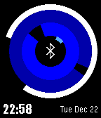</a>

<h2 class="app-name" id="app-5679e58c1606190b07000046"><a href="https://apps.rebble.io/en_US/application/5679e58c1606190b07000046">Rings</a> v2.3-rbl</h2>
<a class="app-source" href="https://edwinfinch.com/redirect/pebble-legacy-source" title="Source code" data-search-exclude>View source</a>

Watchface

Released 2015-12-23 Updated 2021-06-17 Rebble App Store

Runs on: Round 2, Time 2, Pebble 2 Duo, Pebble 2, Time Round, Time, Classic

An old classic from our original collection from 2014-2016, now free &amp; open source!

<a class="app-shot" href="https://apps.rebble.io/en_US/application/563448e6396cf48af1000055" data-search-exclude>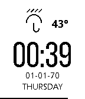</a>

<h2 class="app-name" id="app-563448e6396cf48af1000055"><a href="https://apps.rebble.io/en_US/application/563448e6396cf48af1000055">Plain Weather</a> v2.12-rbl</h2>
<a class="app-source" href="https://edwinfinch.com/redirect/pebble-legacy-source" title="Source code" data-search-exclude>View source</a>

Watchface

Released 2015-10-31 Updated 2021-06-17 Rebble App Store

Runs on: Round 2, Time 2, Pebble 2 Duo, Pebble 2, Time Round, Time, Classic

An old classic from our original collection from 2014-2016, now free &amp; open source!

<a class="app-shot" href="https://apps.rebble.io/en_US/application/55c05b70718511a83a00000b" data-search-exclude>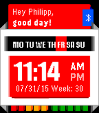</a>

<h2 class="app-name" id="app-55c05b70718511a83a00000b"><a href="https://apps.rebble.io/en_US/application/55c05b70718511a83a00000b">Personal</a> v2.4-rbl</h2>
<a class="app-source" href="https://edwinfinch.com/redirect/pebble-legacy-source" title="Source code" data-search-exclude>View source</a>

Watchface

Released 2015-08-04 Updated 2021-06-17 Rebble App Store

Runs on: Time 2, Pebble 2 Duo, Pebble 2, Time, Classic

An old classic from our original collection from 2014-2016, now free &amp; open source!

<h2 class="app-name" id="app-5588410449c1d102cd000114"><a href="https://apps.rebble.io/en_US/application/5588410449c1d102cd000114">Lines</a> v2.2-rbl</h2>
<a class="app-source" href="https://edwinfinch.com/redirect/pebble-legacy-source" title="Source code" data-search-exclude>View source</a>

Watchface

Released 2015-06-22 Updated 2021-06-17 Rebble App Store

Runs on: Time 2, Pebble 2 Duo, Pebble 2, Time, Classic

An old classic from our original collection from 2014-2016, now free &amp; open source!

<a class="app-shot" href="https://apps.rebble.io/en_US/application/5677521f00088cd53f00006e" data-search-exclude>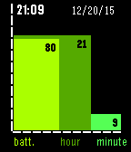</a>

<h2 class="app-name" id="app-5677521f00088cd53f00006e"><a href="https://apps.rebble.io/en_US/application/5677521f00088cd53f00006e">Graph</a> v2.5</h2>
<a class="app-source" href="https://edwinfinch.com/redirect/pebble-legacy-source" title="Source code" data-search-exclude>View source</a>

Watchface

Released 2015-12-21 Updated 2021-06-17 Rebble App Store

Runs on: Time 2, Pebble 2 Duo, Pebble 2, Time, Classic

An old classic from our original collection from 2014-2016, now free &amp; open source!

<h2 class="app-name" id="app-5695fac8a3974593bf00001e"><a href="https://apps.rebble.io/en_US/application/5695fac8a3974593bf00001e">Fireball</a> v2.5-rbl</h2>
<a class="app-source" href="https://edwinfinch.com/redirect/pebble-legacy-source" title="Source code" data-search-exclude>View source</a>

Watchface

Released 2016-01-13 Updated 2021-06-17 Rebble App Store

Runs on: Round 2, Time 2, Time Round, Time

An old classic from our original collection from 2014-2016, now free &amp; open source!

<a class="app-shot" href="https://apps.rebble.io/en_US/application/55d13e160f995067ae000065" data-search-exclude>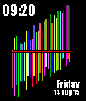</a>

<h2 class="app-name" id="app-55d13e160f995067ae000065"><a href="https://apps.rebble.io/en_US/application/55d13e160f995067ae000065">Equalizer</a> v2.6-rbl</h2>
<a class="app-source" href="https://edwinfinch.com/redirect/pebble-legacy-source" title="Source code" data-search-exclude>View source</a>

Watchface

Released 2015-08-17 Updated 2021-06-17 Rebble App Store

Runs on: Time 2, Pebble 2 Duo, Pebble 2, Time, Classic

An old classic from our original collection from 2014-2016, now free &amp; open source!

<a class="app-shot" href="https://apps.rebble.io/en_US/application/55882b0c0021370a4b0000dc" data-search-exclude>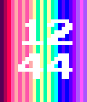</a>

<h2 class="app-name" id="app-55882b0c0021370a4b0000dc"><a href="https://apps.rebble.io/en_US/application/55882b0c0021370a4b0000dc">Colours</a> v2.4-rbl</h2>
<a class="app-source" href="https://edwinfinch.com/redirect/pebble-legacy-source" title="Source code" data-search-exclude>View source</a>

Watchface

Released 2015-06-22 Updated 2021-06-17 Rebble App Store

Runs on: Time 2, Time

An old classic from our original collection from 2014-2016, now free &amp; open source!

<a class="app-shot" href="https://apps.rebble.io/en_US/application/565b4263a5c4c97eba000057" data-search-exclude>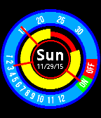</a>

<h2 class="app-name" id="app-565b4263a5c4c97eba000057"><a href="https://apps.rebble.io/en_US/application/565b4263a5c4c97eba000057">Circle Inception</a> v2.5-rbl</h2>
<a class="app-source" href="https://edwinfinch.com/redirect/pebble-legacy-source" title="Source code" data-search-exclude>View source</a>

Watchface

Released 2015-11-29 Updated 2021-06-17 Rebble App Store

Runs on: Round 2, Time 2, Time Round, Time

An old classic from our original collection from 2014-2016, now free &amp; open source!

<a class="app-shot" href="https://apps.rebble.io/en_US/application/55c8cf1c7fde01b16d000003" data-search-exclude>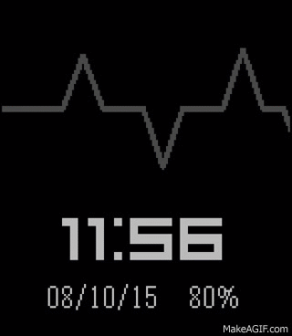</a>

<h2 class="app-name" id="app-55c8cf1c7fde01b16d000003"><a href="https://apps.rebble.io/en_US/application/55c8cf1c7fde01b16d000003">Beat</a> v2.6</h2>
<a class="app-source" href="https://edwinfinch.com/redirect/pebble-legacy-source" title="Source code" data-search-exclude>View source</a>

Watchface

Released 2015-08-10 Updated 2021-06-17 Rebble App Store

Runs on: Time 2, Pebble 2 Duo, Pebble 2, Time, Classic

An old classic from our original collection from 2014-2016, now free &amp; open source!

<a class="app-shot" href="https://apps.rebble.io/en_US/application/52e4ae94561013e64d000122" data-search-exclude>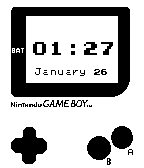</a>

<h2 class="app-name" id="app-52e4ae94561013e64d000122"><a href="https://apps.rebble.io/en_US/application/52e4ae94561013e64d000122">GameBoy for Pebble</a> v1.0</h2>
<a class="app-source" href="https://github.com/edwinfinch/pebbleboy" title="Source code" data-search-exclude>View source</a>

Watchface

No licence Released 2014-01-26 Updated 2014-11-02 Rebble App Store

Runs on: Time 2, Pebble 2 Duo, Pebble 2, Time, Classic

Make your pebble look like a GameBoy! Has 12/24 hour support, the date, and 3 animations. Open source :)

<a class="app-shot" href="https://apps.rebble.io/en_US/application/53eb961fb722c349d70000e4" data-search-exclude>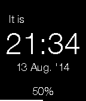</a>

<h2 class="app-name" id="app-53eb961fb722c349d70000e4"><a href="https://apps.rebble.io/en_US/application/53eb961fb722c349d70000e4">Simply Clean</a> v1.1</h2>
<a class="app-source" href="http://www.github.com/edwinfinch/simplyclean" title="Source code" data-search-exclude>View source</a>

Watchface

No licence Released 2014-08-13 Updated 2014-08-14 Rebble App Store

Runs on: Time 2, Pebble 2 Duo, Pebble 2, Time, Classic

Simply Clean was the first watchface I ever built. Keeping it here solely for the throwback. 🙃

