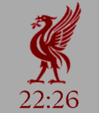

<!-- Generated by scripts/update_app_directory.py: do not edit by hand -->
[← All Pebble Developers](../developers.md)

# efbo

*1 watchface · Last updated 2026-10-11 · [About these lists](../about-app-lists.md)*

Links: [Pebble App Store](https://apps.repebble.com/apps/dev/efbo_52f14ee1e21be4b82000025d) · [GitHub (efboli)](https://github.com/efboli)

<h2 class="app-name" id="app-69c856b70c9231000961ffd8"><a href="https://apps.repebble.com/69c856b70c9231000961ffd8">Liverpool FC Liverbird Watchface</a> v1.2.0</h2>
<a class="app-source" href="https://github.com/efboli/codespaces-pebble/tree/main/Liverbird%20face" title="Source code" data-search-exclude>View source</a>

Watchface · <a href="https://forum.rebble.io/t/806" title="Discuss this app on the Rebble forum" data-search-exclude>Forum thread</a>

Released 2026-03-28 Updated 2026-10-10

Runs on: Round 2, Time 2, Pebble 2 Duo, Pebble 2, Time Round, Time, Classic

A face featuring a Liverbird and the time in LFC Serif, the font used by Liverpool FC in their graphics, website, and around Anfield. Compatible with all Classic Pebbles, Time Series, Time 2 and…

