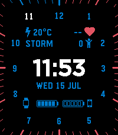

<!-- Generated by scripts/update_app_directory.py: do not edit by hand -->
[← All Pebble Developers](../developers.md)

# EladDvash

*1 watchface and 1 app · Last updated 2026-10-11 · [About these lists](../about-app-lists.md)*

Links: [Pebble App Store](https://apps.repebble.com/apps/dev/eladdvash_68f79f1ed3c6e4000885b87b) · [GitHub (EladDv)](https://github.com/EladDv)

<button type="button" data-filter="all" aria-pressed="true">All 2</button><button type="button" data-filter="watchface" aria-pressed="false">Watchfaces 1</button><button type="button" data-filter="watchapp" aria-pressed="false">Apps 1</button>

<label class="dev-sort">Sort by <select><option value="updated">Recently updated</option><option value="released">Newest release</option><option value="title">A–Z</option></select></label>

<h2 class="app-name" id="app-6a57546ab6d159000924963b"><a href="https://apps.repebble.com/6a57546ab6d159000924963b">ModernAnalogWatch</a> v1.0.3</h2>
<a class="app-source" href="https://github.com/EladDv/ModernAnalog" title="Source code" data-search-exclude>View source</a>

Watchface · <a href="https://forum.rebble.io/t/1158" title="Discuss this app on the Rebble forum" data-search-exclude>Forum thread</a>

Apache-2.0 Released 2026-07-15 Updated 2026-07-17

Runs on: Time 2

Modern Analog is a configurable hybrid digital watchface for Pebble Time 2. It keeps the visual rhythm of a classic clock face without using hands: the current hour is highlighted in white, while…

<h2 class="app-name" id="app-6a428e6a626c07000985a657"><a href="https://apps.repebble.com/6a428e6a626c07000985a657">BusPebbIL</a> v1.2.0</h2>
<a class="app-source" href="https://github.com/EladDv/BusPebbIL" title="Source code" data-search-exclude>View source</a>

App · <a href="https://forum.rebble.io/t/1105" title="Discuss this app on the Rebble forum" data-search-exclude>Forum thread</a>

Apache-2.0 Released 2026-06-29 Updated 2026-07-15

Runs on: Round 2, Time 2, Pebble 2 Duo, Pebble 2, Time Round, Time

Initial Rebble Appstore release for Pebble. Includes live Israeli bus arrivals, favorite stops, nearby stop lookup, manual stop-code lookup, cached fallback data, configurable settings, hidden…

