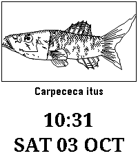
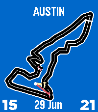

<!-- Generated by scripts/update_app_directory.py: do not edit by hand -->
[← All Pebble Developers](../developers.md)

# Electronic Esoterica

*2 watchfaces · Last updated 2026-10-11 · [About these lists](../about-app-lists.md)*

Links: [Pebble App Store](https://apps.repebble.com/apps/dev/electronic-esoterica_a7debaf5ee7f795688f3e475) · [GitHub (jimbruges)](https://github.com/jimbruges)

<button type="button" data-filter="all" aria-pressed="true">All 2</button><button type="button" data-filter="watchface" aria-pressed="false">Watchfaces 2</button><button type="button" data-filter="watchapp" aria-pressed="false" disabled>Apps 0</button>

<label class="dev-sort">Sort by <select><option value="updated">Recently updated</option><option value="released">Newest release</option><option value="title">A–Z</option></select></label>

<h2 class="app-name" id="app-3f592db18dac4817949a2d64"><a href="https://apps.repebble.com/3f592db18dac4817949a2d64">ReelTime</a> v1.0.2</h2>
<a class="app-source" href="https://github.com/jimbruges/pebble-reeltime" title="Source code" data-search-exclude>View source</a>

Watchface

Released 2026-10-04 Updated 2026-10-04

Runs on: Time 2

A Pebble watchface that draws a new procedurally generated fish on your wrist.

<h2 class="app-name" id="app-765f0c27d5b042e7a6205422"><a href="https://apps.repebble.com/765f0c27d5b042e7a6205422">LapTime - F1 Track Watchface</a> v1.0.7</h2>
<a class="app-source" href="https://github.com/jimbruges/pebble-f1-watchface" title="Source code" data-search-exclude>View source</a>

Watchface

Released 2026-06-29 Updated 2026-07-05

Runs on: Time 2, Pebble 2 Duo, Pebble 2, Time

160 real Formula 1 circuit tracks with cars racing around the track following the time. Features animated race laps, health data cars, analog hands, and a full 2026 F1 race calendar with…

