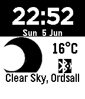

<!-- Generated by scripts/update_app_directory.py: do not edit by hand -->
[← All Pebble Developers](../developers.md)

# Eleni Mikroyannidi

*1 watchface · Last updated 2026-10-12 · [About these lists](../about-app-lists.md)*

Links: [Pebble App Store](https://apps.repebble.com/apps/dev/eleni-mikroyannidi_5509d86484ad02f9f0000054) · [GitHub (elenimikro)](https://github.com/elenimikro)

<h2 class="app-name" id="app-561181e5ce7b4c4a4400001b"><a href="https://apps.repebble.com/561181e5ce7b4c4a4400001b">BBC Weather</a> v1.5</h2>
<a class="app-source" href="https://github.com/elenimikro/bbc-weather-pebbleface" title="Source code" data-search-exclude>View source</a>

Watchface

No licence Released 2015-10-04 Updated 2016-06-05

Runs on: Time 2, Pebble 2 Duo, Pebble 2, Time, Classic

A simple pebble watchface that gets BBC weather data of your location. This is not an official BBC weather app.

