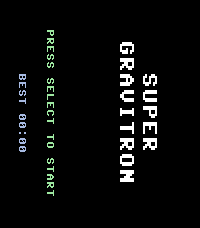

<!-- Generated by scripts/update_app_directory.py: do not edit by hand -->
[← All Pebble Developers](../developers.md)

# Eli Weiss

*1 app · Last updated 2026-10-11 · [About these lists](../about-app-lists.md)*

Links: [Pebble App Store](https://apps.repebble.com/apps/dev/eli-weiss_66e26246b91c38ab22abab14) · [GitHub (eliwss0)](https://github.com/eliwss0)

<h2 class="app-name" id="app-30755d3528b34509bb0b5107"><a href="https://apps.repebble.com/30755d3528b34509bb0b5107">Super Gravitron</a> v0.1.0</h2>
<a class="app-source" href="https://github.com/eliwss0/super-gravitron-pebble" title="Source code" data-search-exclude>View source</a>

App

Released 2026-08-21 Updated 2026-08-21

Runs on: Time 2, Pebble 2 Duo, Pebble 2, Time, Classic

A port of the Super Gravitron minigame from VVVVVV, now on your Pebble! This port is based on the VVVVVV source code and distributed with permission from the game&#x27;s author, Terry Cavanagh.

