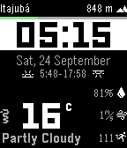

<!-- Generated by scripts/update_app_directory.py: do not edit by hand -->
[← All Pebble Developers](../developers.md)

# Elieser Leão

*1 watchface · Last updated 2026-10-12 · [About these lists](../about-app-lists.md)*

Links: [Pebble App Store](https://apps.repebble.com/apps/dev/elieser-le-o_537f8996048750f65c000026) · [GitHub (elieserleao)](https://github.com/elieserleao)

<h2 class="app-name" id="app-57cbaf2bbe5ad0a9cf00024c"><a href="https://apps.repebble.com/57cbaf2bbe5ad0a9cf00024c">All That Info</a> v1.10</h2>
<a class="app-source" href="https://github.com/elieserleao/allthatinfo" title="Source code" data-search-exclude>View source</a>

Watchface

MIT Released 2016-09-04 Updated 2017-05-03

Runs on: Round 2, Time 2, Pebble 2 Duo, Pebble 2, Time Round, Time, Classic

All info possible. - Open source - Using Weather Underground or OpenWeatherMap (default) - Step counter - Sunrise and sunset - Relative humidity - Current altitude - Wind speed - Watch battery bar

