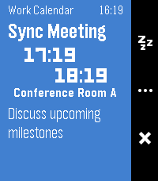

<!-- Generated by scripts/update_app_directory.py: do not edit by hand -->
[← All Pebble Developers](../developers.md)

# Eliza

*1 app · Last updated 2026-10-11 · [About these lists](../about-app-lists.md)*

Links: [Pebble App Store](https://apps.repebble.com/apps/dev/eliza_0554b97fa46644f68f1c3d55) · [GitHub (elizagamedev)](https://github.com/elizagamedev)

<h2 class="app-name" id="app-cda79bd5a8184ab686b5cad3"><a href="https://apps.repebble.com/cda79bd5a8184ab686b5cad3">Flexible Alerts</a> v0.1.2</h2>
<a class="app-source" href="https://github.com/elizagamedev/pebble-alerts" title="Source code" data-search-exclude>View source</a>

App

Released 2026-07-19 Updated 2026-07-19

Runs on: Time 2, Pebble 2 Duo, Pebble 2, Time

Show alerts for your Android calendars, contact birthdays, and anniversaries. Allows you to add reminders to subscribed calendars or events without built-in reminders, which is great for ICS…

