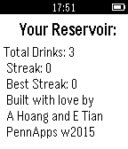

<!-- Generated by scripts/update_app_directory.py: do not edit by hand -->
[← All Pebble Developers](../developers.md)

# Elton Tian, Andrew Hoang

*1 app · Last updated 2026-10-11 · [About these lists](../about-app-lists.md)*

Links: [Pebble App Store](https://apps.repebble.com/apps/dev/elton-tian-andrew-hoang_54b92e29ffc3fdb279000053) · [GitHub (a--hoang)](https://github.com/a--hoang)

<h2 class="app-name" id="app-54c025140badda221300007f"><a href="https://apps.repebble.com/54c025140badda221300007f">Reservoir</a> v1.0</h2>
<a class="app-source" href="https://github.com/a--hoang/pebble-reservoir" title="Source code" data-search-exclude>View source</a>

App

No licence Released 2015-01-21 Updated 2015-01-21

Runs on: Time 2, Pebble 2 Duo, Pebble 2, Time, Classic

Reservoir will help you keep track of your daily water consumption habits and running statistics over time. We hope to make staying hydrated as effortless and entertaining as possible: say bye-bye…

