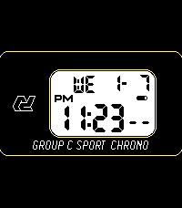

<!-- Generated by scripts/update_app_directory.py: do not edit by hand -->
[← All Pebble Developers](../developers.md)

# elucis

*1 watchface · Last updated 2026-10-12 · [About these lists](../about-app-lists.md)*

Links: [Pebble App Store](https://apps.repebble.com/apps/dev/elucis_68dd8eeaf4fa0700090bb947) · [GitHub (hnguyen094)](https://github.com/hnguyen094)

<h2 class="app-name" id="app-695f44b7ca04f20009aed6c2"><a href="https://apps.repebble.com/695f44b7ca04f20009aed6c2">Dromo GC</a> v1.4</h2>
<a class="app-source" href="https://github.com/hnguyen094/pebble-dromo-gc" title="Source code" data-search-exclude>View source</a>

Watchface · <a href="https://forum.rebble.io/t/454" title="Discuss this app on the Rebble forum" data-search-exclude>Forum thread</a>

Other Released 2026-01-08 Updated 2026-02-14

Runs on: Round 2, Time 2, Pebble 2 Duo, Pebble 2, Time Round, Time, Classic

My first watchface inspired by the Autodromo Group C watch. Not affiliated with Autodromo in any way. Big Features: - Current/Forecasted Weather (temperature, precipitation %, wind speed) - Health…

